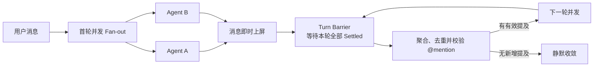
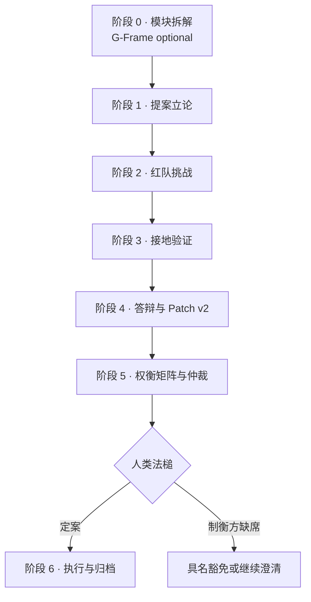
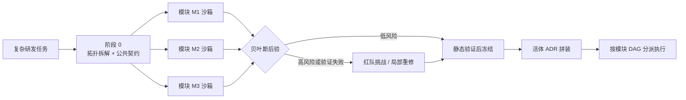
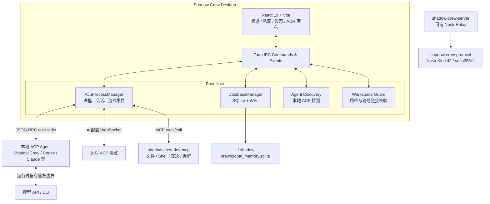

# 🥷 Shadow Crew（Shinobi）

<div align="center">
  
  <p><strong>本地优先的多 Agent 协同与确定性决策工作台</strong></p>
  <p>让拥有独立记忆、工具与工作区的 Agent，在频道和议题中真正协作，而不只是轮流聊天。</p>
</div>

[](https://react.dev/)
[](https://tauri.app/)
[](https://www.rust-lang.org/)
[](https://sqlite.org/)
[](https://agentclientprotocol.com/)

> Shadow Crew 是原 **Shinobi** 项目的当前产品名。它是一套运行在本地桌面端的 Agent 协作空间：用户与多个通过 **ACP（Agent Client Protocol）** 接入的 Agent 共享项目、频道、私聊与议题，并通过普通协同模式或 4+1 博弈裁决模式完成讨论、审查与落地。

---

## 当前能力

| 能力域 | 已落地的实现 |
| :--- | :--- |
| **协同空间** | 项目、频道、私聊、标准议题与博弈议题；支持成员准入、话题抽屉、中途 Steering 插话与跨议题并行执行。 |
| **普通协同模式** | 基于会话水位线的 `<delta-events>` 增量上下文、首轮并发 Fan-out、`Promise.allSettled` Turn Barrier、跨回复 `@mention` 去重和“静默即成功”收敛。 |
| **CognoNexus 4+1 决策** | Proposer → Challenger → Verifier → Defender → Arbiter + Human；FSM 单向推进、阶段契约、法定人数门禁、结构化裁决与后仲裁执行闭环。 |
| **G-Frame 模块化编排** | 2～4 个原子模块拆解、只读公共接口契约、模块上下文物理隔离、文件白名单、贝叶斯先验/后验路由与模块级冻结。 |
| **上下文治理** | 冷/热会话双态 Prompt、1M～2M 上下文模型规格、桌面端 512K 稳态预算、微型总结 Agent 与规则压缩双模降级、Session Key 作用域隔离。 |
| **ACP 运行时** | 自动发现本地 ACP、stdio 进程托管、远程 WebSocket 端点探测、流式输出、取消/中止、会话清理与故障隔离；支持端点通过 `agentCapabilities.nativeMemory` 声明原生长期记忆，Shadow Crew 只负责策略传递与状态核验。 |
| **本地执行授权** | 拦截 ACP `session/request_permission`，提供 Once / Session / Channel / Topic / DM 授权、持久 Grant 管理与 Fail-Closed 超时。 |
| **图片与文件附件** | Composer 支持选择、粘贴和拖放图片/文件；附件持久化并在本地 ACP Prompt 中转换为 `image`、`resource` 或 `resource_link` Content Blocks。 |
| **会话恢复** | SQLite 持久化 Session 映射；支持 `session/load` 时优先协议级恢复，否则以 `session/new` + 平台层增量上下文补偿。 |
| **本地工具链** | 内置 `shadow-crew-dev-mcp`，提供文件读写、搜索、Shell、Channel/Agent Artifact、`submit_arbitration_ruling` 与 `submit_module_decomposition`。 |
| **本地数据与审计** | SQLite 单一事实源、WAL 并发读写、工作区路径校验、符号链接/TOCTOU 防护、运行日志与消息历史本地留存。 |
| **可选基础设施** | 远程 ACP WebSocket 与独立 `shadow-crew-server` Nostr Relay 作为演进能力保留；默认本地协作不依赖远端 Relay。 |

---

## 协作与决策编排

### 1. 普通协同模式：增量上下文 + 轮内并发

适用于问答、头脑风暴、方案评审和跨工种协作。首轮可并行唤醒多个 Agent；每个 Agent 完成后立即上屏，但只有本轮全部结束后才进入下一跳判定。



关键设计：

- 每个 `(roomId, agentId)` 独立维护会话水位线，水位线在 **投递时更新**，避免并发乱序导致漏读或重复读取。
- 冷启动一次性注入议题背景与成员信息；热会话只发送未读 `<delta-events>`，减少重复上下文并提高 Prefix Cache 命中率。
- 单批最多 50 条增量事件；系统消息、Pending 占位和 Agent 自身发言会被过滤。
- 本轮多个 Agent 同时点名同一目标时只唤醒一次，并合并调用方与来源消息。
- 默认协同链最大深度为 12；无新增信息时自然静默，异常回环另有单 Agent 频次兜底。
- `<delta-events>`、`<topic-context>` 等语义边界文本会被转义，避免外部消息伪造系统指令。

详细规范：[普通模式增量上下文与并发编排规范](docs/SPEC_NORMAL_MODE_BUZZ_CONTEXT_AND_CONCURRENT_ORCHESTRATION.md)

### 2. 博弈裁决模式：CognoNexus 4+1

适用于高风险架构选型、复杂 Bug 归因、安全边界评审等需要“攻击—验证—修正—裁决”的场景。



四类机器人角色加一位人类终审者：

| 角色 | 职责 |
| :--- | :--- |
| 🏛️ **Proposer** | 探索解空间，提交方案 v1，并根据反例输出防御补丁 v2。 |
| ⚔️ **Challenger** | 指定异议者，寻找逻辑漏洞、脆弱假设和极端失效工况。 |
| 🔍 **Verifier** | 不参与主观辩论，负责只读检索、静态检查与受控沙箱验证。 |
| ⚖️ **Arbiter** | 汇总证据与权衡矩阵，通过结构化 MCP 契约提交裁决草案。 |
| 👤 **Human** | 持有最终法槌；缺席豁免必须具名并留痕。 |

博弈模式不只依赖 Prompt 约束，而是由 FSM 和代码门禁共同控制。技术报告中的 **7 大 Token 控制机制 + 9 大结果趋真机制** 已进入主链路：

| Token 控制 | 结果趋真 |
| :--- | :--- |
| Wald-SPRT 早停与死锁熔断 | DIANOIA 4+1 职能解耦与 6 阶段 FSM |
| LMAD Top-5 论点抽取、Claim DAG 与三态脱水 | Free-MAD 去共识化红队契约 |
| 阶段靶点按需挂载与滑动窗口截断 | T1/T2 接地验证、原子承诺链与未实证早停锁 |
| 静默收敛与 LoopGuard | BSS/DSS 谄媚量化、投降拦截与信任折减 |
| 阶段契约有界 Self-Refine（最多 2 次） | ReConcile 异构模型检测与校准置信度矩阵 |
| ColMAD 冗余与车轱辘话惩罚 | LLM + BWM 确定性求解与 `ξ* ≤ 0.12` 一致性门禁 |
| 神经符号计算卸载与 MCP 契约直通 | 少数派异议报告、Quorum Gate 与活体 ADR |

完整说明：[Token 消耗控制与决策准确性保障技术报告](docs/TECH_REPORT_GAME_THEORETIC_TOKEN_AND_ACCURACY_GOVERNANCE.md)

### 3. G-Frame 模块化分治

复杂任务先在阶段 0 拆成 2～4 个单一职责模块，并锁定跨模块只读公共接口契约。之后每个模块只看到自己的职责、允许文件和公共契约，避免长篇全量上下文造成接口漂移与跨模块回归。



- `allowedFiles` 构成模块爆炸半径，越界修改或白名单重叠会被拦截。
- 低风险模块可走 `fast_track`；契约违规、证伪主张或边缘案例增加会推动后验风险上升并升级到 `deep_debate`。
- 已冻结模块不参与其他模块的重新生成，故障只在当前模块沙箱内局部修复。
- Wave 1（类型与贝叶斯调控器）、Wave 2（MCP 拆解与上下文隔离）、Wave 3（模块矩阵与 ADR）均已接入。

详细规范：[G-Frame 贝叶斯模块化编排规范](docs/SPEC_GFRAME_BAYESIAN_MODULAR_ORCHESTRATION.md)

---

## 系统架构

Shadow Crew 当前以 **Tauri 桌面宿主 + React 工作台** 为主路径。频道消息、实体状态、记忆与 ACP Session 均默认保存在本机 SQLite；Agent 通过 ACP 独立运行，平台只负责编排、协议桥接、状态治理与结果归档。



### 技术栈

- **桌面端**：Tauri 2、Rust、Tokio
- **前端**：React 19、TypeScript 5.8、Vite 6、Tailwind CSS 4
- **Agent 协议**：ACP JSON-RPC 2.0、MCP
- **持久化**：SQLite、WAL
- **分布式协议基础**：Axum 0.8、Nostr Kind 42、secp256k1（可选 Relay 层）

### 本地数据布局

```text
~/.shadow-crew/
├── global_memory.sqlite        # 消息、Agent、频道、议题、记忆与 ACP Session
├── channels/<channel_id>/      # 频道公共工作区、artifacts、scratch
├── agents/<agent_id>/          # Agent 私有工作区
└── logs/acp.log                # ACP 运行日志
```

可通过 `SHADOW_CREW_HOME` 调整运行根目录，通过 `SHADOW_CREW_MEMORY_DB` 指定数据库路径。日志与数据库可能包含讨论正文，分享诊断材料前应先脱敏。

---

## 项目结构

```text
shadow-crew/
├── src/                              # React 工作台与协同编排
│   ├── App.tsx                       # 应用核心工作区、主消息流与协同挂载根
│   ├── components/                   # 频道、议题、ADR、Agent 配置等 UI
│   │   └── AppModalsContainer.tsx    # 集中化弹窗容器（团队、存储、频道、Agent 连接等）
│   ├── hooks/                        # 核心业务与编排状态机 Hooks
│   │   ├── useResizablePanel.ts      # 侧边栏/分栏拖拽缩放
│   │   ├── useTopicExecutionPipeline.ts # G-Frame 拓扑落地执行与工作区 Diff 合入管线
│   │   ├── useArbitrationConcurrence.ts # 仲裁裁决合流、全员无异议征询与 Living ADR
│   │   └── useGameTheoreticFsm.ts    # CognoNexus 4+1 博弈推演状态机控制器
│   ├── services/
│   │   ├── agentCollaboration.ts     # 增量上下文、Prompt 编译与 Turn Barrier
│   │   ├── acpClient.ts              # ACP 前端契约、流式事件与会话清理
│   │   ├── llmService.ts             # 应用内部模型调用与配置（不承担 ACP Agent 推理）
│   │   └── cogno/                    # SPRT、LMAD、BWM、G-Frame 等治理引擎
│   └── types.ts                      # 领域模型、FSM 与治理状态类型
├── src-tauri/                        # Tauri 桌面宿主
│   └── src/
│       ├── main.rs                   # Tauri Commands 与应用入口
│       ├── acp_manager.rs            # ACP 进程、Session 生命周期与恢复
│       └── db_manager.rs             # SQLite 单一事实源与存储治理
├── crates/
│   ├── shadow-crew-protocol/         # ACP / Nostr 共享协议结构
│   ├── shadow-crew-dev-mcp/          # 可选开发与决策 MCP Server
│   └── shadow-crew-server/           # 可选 Axum Nostr Relay
├── bin/codex-acp                     # Codex ACP 适配桥
├── docs/                             # PRD、技术规范、测试方案与架构决策
├── scripts/                          # 迁移与辅助脚本
└── public/                           # 桌面与 Web 品牌资源
```

---

## 本地 Debug 运行

本地调试分为两种入口：

- **完整 Tauri 桌面端**：同时启动 Vite 前端与 Rust 宿主，支持 ACP Agent、SQLite、文件对话框、本地工作区和 Tauri IPC。联调核心功能时使用此入口。
- **仅 Vite 前端**：只启动 React 页面，适合检查布局、样式和纯前端状态；无法使用 ACP 进程托管、SQLite 命令和本地工作区能力。

### 1. 提前安装依赖

| 依赖 | 必要性 | 版本或说明 |
| :--- | :--- | :--- |
| Git | 必需 | 用于获取源码和管理本地提交。 |
| Node.js + npm | 必需 | 锁文件中的 Vite React 插件要求 Node.js `20.19+` 或 `22.12+`；推荐使用 Node.js 22 LTS。npm 随 Node.js 安装。 |
| Rust stable + Cargo | 必需 | 通过 `rustup` 安装当前 stable 工具链，用于编译 Tauri 宿主与工作区 Rust crate。 |
| Tauri 2 系统依赖 | 必需 | 包括 WebView、C/C++ 编译器和平台系统库，安装方式见下方。 |
| ACP Agent | 功能联调时必需 | 如需实际对话，安装 Codex、Claude Code 等 Agent 及其 ACP 适配器，并完成该运行时的模型认证。仅检查界面时可以暂不安装。 |

先确认基础工具链可用：

```bash
node --version
npm --version
rustc --version
cargo --version
git --version
```

如果尚未安装 Rust，macOS / Linux 可通过 [rustup](https://rustup.rs/) 安装：

```bash
curl --proto '=https' --tlsv1.2 -sSf https://sh.rustup.rs | sh
rustup default stable
```

Windows 请安装 `stable-x86_64-pc-windows-msvc` 工具链，并确保 Rust 使用 MSVC ABI。

### 2. 安装 Tauri 2 平台依赖

完整要求可参考 [Tauri 2 Prerequisites](https://v2.tauri.app/start/prerequisites/)。

**macOS**

安装 Xcode Command Line Tools；如果已安装完整 Xcode，也应确保命令行工具路径有效。项目当前在 macOS 上以 Xcode Command Line Tools / Xcode 构建。

```bash
xcode-select --install
xcode-select -p
```

**Windows**

- 安装 **Microsoft C++ Build Tools**，勾选“使用 C++ 的桌面开发”和 Windows SDK。
- 安装 **Microsoft Edge WebView2 Runtime**；Windows 11 通常已预装。

**Debian / Ubuntu**

```bash
sudo apt update
sudo apt install \
  libwebkit2gtk-4.1-dev \
  build-essential \
  curl wget file \
  libxdo-dev \
  libssl-dev \
  libayatana-appindicator3-dev \
  librsvg2-dev
```

安装完成后，可在项目根目录运行 Tauri 环境诊断：

```bash
npm run tauri -- info
```

### 3. 安装项目依赖

在仓库根目录执行：

```bash
npm ci
```

这里使用 `npm ci` 按 `package-lock.json` 安装确定性依赖。首次启动桌面端时，Cargo 还会下载并编译 Rust 依赖，耗时会明显长于后续增量编译。

`shadow-crew-dev-mcp` 主链路并不要求提前单独构建；仅在调试该 Rust MCP crate 时执行：

```bash
cargo build -p shadow-crew-dev-mcp
```

### 4. 启动完整桌面 Debug

```bash
npm run dev:desktop
```

该命令等价于 Tauri debug 启动流程：

1. 由 `beforeDevCommand` 自动执行 `npm run dev`，启动 Vite，默认地址为 `http://localhost:3033`。
2. 编译并启动 `shadow-crew-desktop` 的 Rust debug 二进制。
3. 打开 Tauri 桌面窗口，前端修改支持 Vite HMR，Rust 宿主修改会触发重新编译和应用重启。

终端出现 Vite 监听地址并打开桌面窗口后即启动完成。按 `Ctrl+C` 同时停止桌面端和 Vite 开发服务器。

首次启动后，在 **Agents** 面板连接本地或远程 ACP 运行时。应用会自动扫描可用的 ACP 适配器；Agent 的模型认证和环境变量由对应运行时管理。仓库自带 `bin/codex-acp` 桥接器，`npm ci` 也会安装项目局部的 Codex CLI 依赖。

若 Codex 未被自动发现，可显式指定二进制后启动：

```bash
CODEX_BINARY="$PWD/node_modules/.bin/codex" npm run dev:desktop
```

如需让 debug 数据与日常使用的 `~/.shadow-crew` 隔离，可指定临时运行根目录：

```bash
SHADOW_CREW_HOME="/tmp/shadow-crew-debug" npm run dev:desktop
```

macOS / Linux 默认 ACP 日志位于 `~/.shadow-crew/logs/acp.log`；指定 `SHADOW_CREW_HOME` 后，日志和 SQLite 数据会写入该目录下。

### 5. 仅启动前端

```bash
npm run dev
```

然后在浏览器打开 `http://localhost:3033`。此模式不会启动 Rust 宿主，以下能力不可用或只能走内存/浏览器降级实现：

- ACP Agent 进程启动、流式事件与取消；
- SQLite 持久化和 Tauri IPC；
- 本地文件选择、打开与工作区读写；
- 需要通过桌面宿主访问的原生能力。

### 6. 启动前后检查

建议在提交前至少执行：

```bash
npm run lint
npm run build
```

如果 `npm ci`、`cargo build` 或 Tauri 窗口启动失败，优先重新执行 `npm run tauri -- info`，确认 Node.js、Rust、Xcode / MSVC、WebView2 和 Linux 系统库均已满足要求。

### 生产构建

```bash
npm run build
npm run tauri build
```

桌面安装包输出位置由 Tauri bundle 配置决定，当前 targets 包含 macOS、Debian 与 Windows NSIS。

### 可选：启动 Nostr Relay

```bash
cargo run -p shadow-crew-server
```

该服务默认监听 `ws://127.0.0.1:8080/relay`，属于可选基础设施；它不是本地桌面协作链路的启动前置条件。

---

## 质量门禁

提交前至少执行：

```bash
# TypeScript 类型检查
npm run lint

# 前端生产构建
npm run build

# CognoNexus + G-Frame 主回归
npm run test:cogno
npm run test:cogno:edge

# 普通模式增量上下文与并发编排
npx tsx src/services/test-normal-mode-buzz-orchestration.ts

# 上下文预算与双模压缩
npx tsx src/services/test-llm-compaction-governance.ts

# @mention 解析与边界保护
npx tsx src/services/test-mention-resolution.ts

# Rust MCP 工具契约
cargo test -p shadow-crew-dev-mcp
```

涉及 Agent 进程、Session 清理、工作区隔离或 Game FSM 的修改，还应补充对应的运行期回归。仓库交付规则见 [AGENTS.md](AGENTS.md)：完成修改后执行必要性验证，并以原子化、语义化 commit 固化结果。

---

## 技术方案索引

| 文档 | 当前定位 |
| :--- | :--- |
| [Token 消耗控制与决策准确性保障技术报告](docs/TECH_REPORT_GAME_THEORETIC_TOKEN_AND_ACCURACY_GOVERNANCE.md) | CognoNexus 全景技术报告；7 大 Token 控制、9 大准确性机制及 10 篇论文映射。 |
| [4+1 博弈编排协议规范](docs/SPEC_GAME_THEORETIC_ORCHESTRATION_PROTOCOL.md) | FSM、阶段载荷、Quorum Gate、后仲裁执行与 CognoNexus 核心算法。 |
| [G-Frame 贝叶斯模块化编排规范](docs/SPEC_GFRAME_BAYESIAN_MODULAR_ORCHESTRATION.md) | 模块拓扑拆解、公共契约、上下文隔离、贝叶斯调控与 Wave 1～3 落地方案。 |
| [普通模式增量上下文与并发编排规范](docs/SPEC_NORMAL_MODE_BUZZ_CONTEXT_AND_CONCURRENT_ORCHESTRATION.md) | 生产生效中的 `<delta-events>` 水位线、冷热双态 Prompt 与 Turn Barrier。 |
| [ACP 原生记忆能力规范](docs/SPEC_ACP_NATIVE_MEMORY.md) | `agentCapabilities.nativeMemory` 扩展、Agent 策略、Codex 映射与验收用例。 |
| [Messaging Space PRD](docs/PRD_MESSAGING_SPACE.md) | 项目、频道、私聊、议题和成员模型。 |
| [多 Agent 讨论与 Steering PRD](docs/PRD_MULTI_AGENT_DISCUSSION_AND_STEERING.md) | 轮次治理、终止机制、中途插话与旁路议题。 |
| [远程 ACP 与记忆流转 PRD](docs/PRD_ACP_REMOTE_AND_MEMORY.md) | 跨端远程连接、`.acpmem` 记忆导出/导入与安全边界，仍按演进项治理。 |
| [远程 ACP 与记忆技术规范](docs/TECH_SPEC_ACP_REMOTE_AND_MEMORY.md) | Transport Bridge、记忆漏斗、IPC 契约与实施路线。 |
| [多 Agent 测试指南](docs/TestDocs/multi_agent_test_suite_and_guide.md) | 真实桌面端多轮接力、无屏障并发与收敛验收用例。 |

建议阅读顺序：**普通模式规范 → 4+1 协议 → Token/准确性技术报告 → G-Frame 规范 → 测试指南**。

---

## 当前边界与下一阶段

Shadow Crew 当前坚持 **local-first**：

- 默认消息、状态、记忆和 Session 都由本地 SQLite 管理；桌面端主协作链路不依赖云端 Relay。
- 远程 ACP WebSocket 已具备连接配置与请求能力，但跨端身份、配额、审计与断线恢复仍需按技术规范继续加固。
- `shadow-crew-server` 与 Nostr Kind 42 是可选协议基础；默认桌面宿主尚未把入站订阅作为主协作链路。
- 性能、节省比例等指标应以本地运行数据为准，不以理论值替代可观测结果。

下一阶段重点：

1. 完成真实桌面端 4 Agent、多轮次长链路验收，覆盖会话清理、进程重启、模式切换与增量上下文。
2. 建立热会话上下文缩减率、压缩延迟、摘要降级率、错误率与端到端延迟基线。
3. 继续推进远程 ACP、记忆包迁移和可选 Relay 的鉴权、配额与审计治理。
4. 保持 CognoNexus 与 G-Frame 回归基线，持续验证“低 Token”与“高可信裁决”不是互斥目标。

---

<div align="center">
  <strong>先把协作做真，再把规模做大。</strong>
</div>
