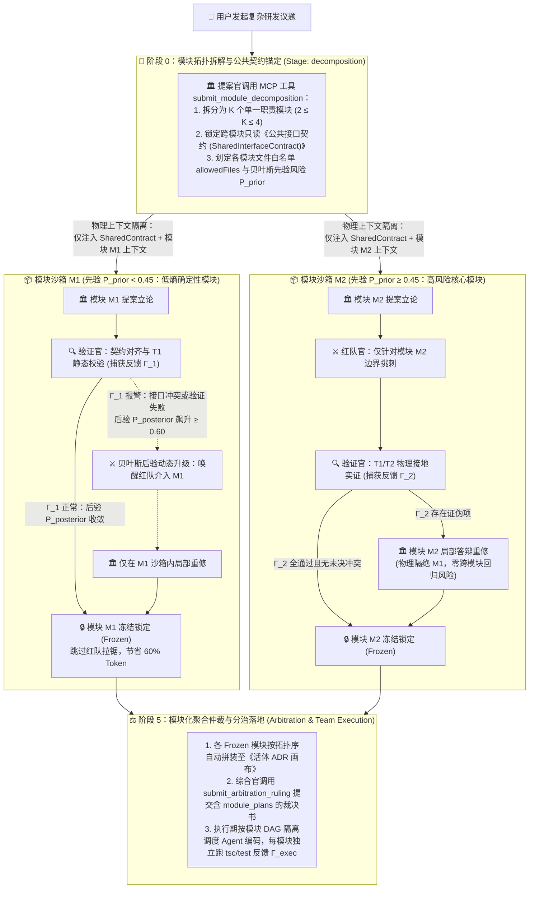

# 🥷 Shadow Crew (CognoNexus × G-Frame) 贝叶斯与团队博弈驱动的模块化分治编排规范与落地方案

> **文档编号**：`SPEC_GFRAME_BAYESIAN_MODULAR_ORCHESTRATION`  
> **版本**：v1.0.0 (G-Frame Dual-Layer Modular Governance)  
> **状态**：架构设计与落地规范 (Implementation Blueprint)  
> **关联文档**：
> - [`TECH_REPORT_GAME_THEORETIC_TOKEN_AND_ACCURACY_GOVERNANCE.md`](file:///Users/xunuosi/Code/Lx/AI/shadow-crew/docs/TECH_REPORT_GAME_THEORETIC_TOKEN_AND_ACCURACY_GOVERNANCE.md)
> - [`SPEC_GAME_THEORETIC_ORCHESTRATION_PROTOCOL.md`](file:///Users/xunuosi/Code/Lx/AI/shadow-crew/docs/SPEC_GAME_THEORETIC_ORCHESTRATION_PROTOCOL.md)
> - [`PRD_MULTI_AGENT_DECISION_ACCURACY_GOVERNANCE.md`](file:///Users/xunuosi/Code/Lx/AI/shadow-crew/docs/PRD_MULTI_AGENT_DECISION_ACCURACY_GOVERNANCE.md)

---

## 1. 背景与核心问题定义

### 1.1 现有 `CognoNexus 4+1` 纵向解耦的边界与局限
在现有的 `CognoNexus 4+1` 博弈架构中，我们基于 **DIANOIA** 与 **Free-MAD** 实现了**纵向认知职能解耦**（提案官 `Proposer` $\rightarrow$ 红队对抗官 `Challenger` $\rightarrow$ 接地验证官 `Verifier` $\rightarrow$ 综合协调官 `Arbiter` + 人类终审法槌）。

然而，在面对**跨模块、长链路的复杂软件工程任务**（例如同时涉及底层数据结构、Rust 后端命令与 React 前端状态机的需求）时，现有模式仍存在三个结构性瓶颈：

1. **单次全量自回归的信息熵扩散（Entropy Diffusion）**：
   - 在阶段 1（`proposal`），提案官面对的是未经拆解的完整大任务，必须在单次长文本生成中同时规划所有模块。
   - 随着自回归生成步数增加，条件概率分布发散（信息熵升高），导致生成分布与真实工程约束之间的 **KL 散度（Kullback-Leibler Divergence）** 显著增大，表现为“前半段模块设计严密，后半段模块开始遗漏边界、写错接口名或产生局部幻觉”。
2. **事后论点提取的被动性（Post-hoc Claim Extraction）**：
   - 现有的 [`lmadConflictLocalizer.ts`](file:///Users/xunuosi/Code/Lx/AI/shadow-crew/src/services/cogno/lmadConflictLocalizer.ts) 是在提案官写完数千字全量方案后，才事后抽取 Top-5 论点节点构建 `Claim DAG`，无法在提案生成源头就通过缩小问题边界来压制幻觉。
3. **局部答辩重修引发的跨模块退化（Cross-Module Regression）**：
   - 当方案中的某一个子模块（如模块 B）被红队或验证官证伪时，提案官在 `defense` 阶段重写方案时往往会携带全量上下文，极易出现“修好了模块 B，却在重新生成时把原本正确的模块 A 改坏或漏掉”的连锁偏移。

---

### 1.2 引入 `G-Frame` 双层博弈理论的核心思想
借鉴 **G-Frame（贝叶斯与团队博弈驱动的多智能体协作框架）**，我们将原有的“单轨全量 4+1 博弈”升级为 **“宏观贝叶斯博弈动态控制 + 微观团队博弈模块隔离”** 的正交双层架构：

| 维度 | G-Frame 理论机制 | 数学本质 | 在 Shadow Crew 中的工程映射 |
| :--- | :--- | :--- | :--- |
| **微观层：<br>团队博弈 (Team Game)** | 将复杂大任务前置拆解为职责单一、边界受限的原子子任务，由 Agent 在各自受限域内协作完成全局效用 $U(a_1, \dots, a_K)$。 | 缩小单步条件上下文空间，压制生成信息熵 $H(Y \mid X_k, \mathcal{C}_{\text{shared}})$，降低与真实分布的 **KL 散度**。 | **提案起点模块分块 + 独立上下文沙箱（Module Sandbox）**：<br>先锚定跨模块只读《公共接口契约》，再为每个模块开辟物理隔离的上下文窗口与专属文件白名单 `allowedFiles`。 |
| **宏观层：<br>贝叶斯博弈 (Bayesian Game)** | 决策控制器将系统建模为 POMDP，遵循 **先验决策 $d^{\text{prior}} \xrightarrow{\text{反馈 } \Gamma} \text{后验决策 } d^{\text{posterior}}$** 动态调度资源与策略。 | 结合先验风险分布 $P(H_k)$ 与实证似然 $P(\Gamma_k \mid H_k)$，实时计算后验风险 $P(H_k \mid \Gamma_k)$，按需分配算力。 | **贝叶斯模块动态深度调控器（`BayesianModuleGovernor`）**：<br>低风险模块走“提案 $\rightarrow$ 静态验证 $\rightarrow$ 冻结”快速通道；高风险或验证异常模块动态拉起“红队深潜 + 局部重修”，兼顾高准确与低 Token。 |

---

## 2. 总体架构设计：前置拓扑拆解 + 公共契约总线 + 贝叶斯模块沙箱

### 2.1 全链路双层博弈流转图



---

### 2.2 三大关键架构防坑机制

#### 机制一：跨模块只读《公共接口契约（Shared Interface Contract）》—— 杜绝“局部最优但全局拼不上”
* **设计原则**：各模块上下文物理隔离的前提，是**共享同一份不可私自篡改的边界契约**。
* **运作方式**：
  1. 在阶段 0（`decomposition`），提案官不写任何模块内部的业务实现代码，只输出：
     - 模块划分列表 $M = \{m_1, m_2, \dots, m_K\}$（硬限制 $2 \le K \le 4$，防止过度碎片化）；
     - 跨模块通信的数据结构、函数签名或事件载荷定义（`SharedInterfaceContract`，控制在 `300` 字符以内）。
  2. 在后续任意模块 $m_k$ 的独立讨论中，`SharedInterfaceContract` 作为**置顶只读常量**注入该模块的 Prompt 中，确保模块 A 产出的数据结构与模块 B 消费的接口签名 100% 严丝合缝。

#### 机制二：贝叶斯先验分流与后验动态升降级 —— 杜绝“模块分块导致 Token 倍增”
* **设计原则**：并非所有子模块都需要经历完整的“提案 $\rightarrow$ 红队挑战 $\rightarrow$ 验证 $\rightarrow$ 答辩”四轮交锋。
* **三步贝叶斯调控闭环**：
  1. **先验决策（Prior $d^{\text{prior}}$）**：根据模块涉及领域计算先验风险概率 $P_{\text{prior}}(m_k) \in [0.10, 0.90]$：
     - **低熵模块**（$P_{\text{prior}} < 0.45$，如纯类型定义、常量配置、简单 UI 映射）：默认路由至 **`fast_track`（快速验证流）**，仅执行 `模块提案 -> 验证官静态契约检查 -> 冻结`，直接省去红队与答辩环节；
     - **高熵模块**（$P_{\text{prior}} \ge 0.45$，如并发调度、状态机流转、数据库迁移、安全鉴权）：默认路由至 **`deep_debate`（深度对抗流）**，在模块隔离沙箱内执行完整红队对抗。
  2. **实时反馈捕获（Feedback Vector $\Gamma_k$）**：在模块推演过程中，采集四维客观反馈信号：
     $$\Gamma_k = \left(\text{ContractViolation}_k,\; \text{RefutedClaimCount}_k,\; \text{EdgeCaseDensity}_k,\; \text{DSS}_k\right)$$
  3. **后验更新（Posterior $d^{\text{posterior}}$）**：利用贝叶斯似然比更新模块风险后验概率 $P_{\text{posterior}}(m_k \mid \Gamma_k)$：
     - **后验升级（Escalation）**：若原本走 `fast_track` 的低风险模块在静态检查时被发现接口签名不匹配（$\text{ContractViolation}_k > 0$）或编译隐患，$P_{\text{posterior}}$ 立即跃升至 $\ge 0.65$，系统动态拉起红队挑战官介入该模块；
     - **后验早停（Early Freeze）**：若高风险模块在首轮即通过全部 T1/T2 实证且无未决反例，$P_{\text{posterior}}$ 降至 $< 0.20$，立即将该模块状态置为 `frozen`（已冻结）。

#### 机制三：模块级上下文物理隔离与故障硬冻结 —— 杜绝“改 B 坏 A”的回归幻觉
* **上下文物理切片**：当任意角色 Agent 被调度处理模块 $m_k$ 时，宿主组装的上下文仅包含：
  $$\text{Context}(m_k) = \underbrace{\mathcal{C}_{\text{shared}}}_{\text{公共接口契约}} \oplus \underbrace{\text{Spec}(m_k)}_{\text{本模块职责与 allowedFiles}} \oplus \underbrace{\text{History}(m_k)}_{\text{仅限本模块沙箱内的历史发言}}$$
  其他模块 $m_{j \ne k}$ 的长篇推理与代码细节对当前 Agent **完全不可见**。
* **单模块局部重修（Scoped Self-Refine & Defense）**：一旦模块 $m_2$ 被证伪，仅在 $m_2$ 的沙箱内唤醒提案官输出补丁；处于 `frozen` 状态的模块 $m_1$ 被硬锁定在已承诺台账中，不参与任何重生成。

---

## 3. 核心数据结构与接口契约设计

### 3.1 前端核心类型扩展（[`src/types.ts`](file:///Users/xunuosi/Code/Lx/AI/shadow-crew/src/types.ts)）

在 [`src/types.ts`](file:///Users/xunuosi/Code/Lx/AI/shadow-crew/src/types.ts) 中扩展 `GameTheoreticStage` 并新增 `G-Frame` 模块化治理类型：

```typescript
/**
 * 扩展后的博弈状态机阶段枚举：
 * 新增可选前置阶段 'decomposition'（阶段 0：模块拓扑拆解与公共契约锚定）
 */
export type GameTheoreticStage =
  | 'decomposition' // 阶段 0: G-Frame 模块拆解与跨模块接口契约锚定
  | 'proposal'      // 阶段 1: 模块化/整体提案立论 (v1)
  | 'challenge'     // 阶段 2: 红队极端反例压测与反向质询
  | 'verification'  // 阶段 3: 接地验证纯工具执行与真值检验
  | 'defense'       // 阶段 4: 提案方模块级局部答辩与防御补丁 (v2)
  | 'arbitration'   // 阶段 5: 综合协调起草权衡矩阵 / 人类法槌终局定案
  | 'concluded';    // 终态: 已裁决归档并支持按模块 DAG 分治落地

/**
 * 跨模块只读公共接口契约 (Shared Interface Contract)
 * 用于在上下文隔离的同时保证各模块接口 100% 严丝合缝
 */
export interface SharedInterfaceContract {
  contractVersion: number;
  summary: string;                  // 核心架构边界简述 (≤ 150 字)
  typeSignatures: string;           // 跨模块共享的 TypeScript Interface / Rust Struct / API 签名代码块
  invariants: string[];             // 全局不可违背的不变量约束 (如："严禁直接操作底层 SQLite，必须经由 Repository 接口")
  lockedAt: string;
}

/**
 * 贝叶斯模块风险与反馈状态 (Bayesian Module Belief State)
 */
export interface BayesianModuleBelief {
  priorRisk: number;                // 先验不确定性/风险概率 P_prior ∈ [0.05, 0.95]
  posteriorRisk: number;            // 后验更新后风险概率 P_posterior ∈ [0.05, 0.95]
  routingMode: 'fast_track' | 'deep_debate'; // 贝叶斯路由模式：快速通道 vs 深度红队对抗
  feedbackVector: {                 // 实时捕获的反馈信号向量 Γ_k
    contractViolations: number;     // 违反公共接口契约次数
    verifiedClaims: number;         // 已通过物理接地验证的断言数
    refutedClaims: number;          // 被证伪的断言数
    edgeCaseCount: number;          // 红队挖掘的极端边界反例数
    dssScore: number;               // 模块内动态谄媚分
  };
  lastUpdatedAt: string;
}

/**
 * G-Frame 单一职责原子模块切片 (Task Module Slice)
 */
export interface TaskModuleSlice {
  moduleId: string;                 // 模块唯一标识，如 "mod-1-schema", "mod-2-engine"
  title: string;                    // 模块名称，如 "模块 1：核心类型与状态契约定义"
  responsibility: string;           // 单一职责边界说明
  allowedFiles: string[];           // 本模块允许读写的文件路径白名单 (爆炸半径硬约束)
  dependsOnModuleIds: string[];     // 依赖的上游模块 ID 列表 (构成 Module DAG)
  status: 'pending' | 'proposing' | 'challenging' | 'verifying' | 'defending' | 'frozen' | 'failed';
  belief: BayesianModuleBelief;     // 贝叶斯先验-反馈-后验状态
  scopedMessageIds: string[];       // 物理隔离：仅属于本模块沙箱的消息 ID 集合
  frozenProposalSnippet?: string;   // 模块冻结定案后的最终方案摘要/代码契约
  assignedExecutorId?: string;      // 落地阶段指派给本模块的专职执行 Agent ID
  executionVerificationPassed?: boolean; // 执行期本模块静态检查/单测是否通过
}

/**
 * G-Frame 模块化分治编排总状态 (挂载于 GameTheoreticState.modularState)
 */
export interface ModularOrchestrationState {
  enabled: boolean;                 // 是否启用 G-Frame 模块化隔离分治
  sharedContract?: SharedInterfaceContract;
  modules: TaskModuleSlice[];       // K 个原子模块切片 (2 ≤ K ≤ 4)
  activeModuleId?: string;          // 当前正在推演或聚焦的模块沙箱 ID
  overallEntropyReductionRatio?: number; // 相比全量上下文的 Token/信息熵压缩比 (0~1)
}
```

---

### 3.2 宿主 Rust MCP 工具契约设计（[`crates/shinobi-dev-mcp/src/tools/mod.rs`](file:///Users/xunuosi/Code/Lx/AI/shadow-crew/crates/shinobi-dev-mcp/src/tools/mod.rs)）

遵循项目核心编码准则（**禁止前端脆弱正则猜测，全面采用 MCP 工具结构化契约直通**），在 `shinobi-dev-mcp` 中新增阶段 0 专用工具 `submit_module_decomposition`：

```json
{
  "name": "submit_module_decomposition",
  "description": "在 G-Frame 博弈阶段 0 (decomposition) 提交任务模块化拆解清单与跨模块公共接口契约。将复杂研发任务拆解为 2~4 个职责正交、上下文隔离的原子模块。",
  "inputSchema": {
    "type": "object",
    "required": ["shared_contract", "modules"],
    "properties": {
      "shared_contract": {
        "type": "object",
        "required": ["summary", "type_signatures", "invariants"],
        "properties": {
          "summary": { "type": "string", "description": "跨模块架构边界简述" },
          "type_signatures": { "type": "string", "description": "跨模块共享的接口/数据结构签名定义" },
          "invariants": {
            "type": "array",
            "items": { "type": "string" },
            "description": "所有模块必须遵守的全局不变量约束"
          }
        }
      },
      "modules": {
        "type": "array",
        "minItems": 2,
        "maxItems": 4,
        "items": {
          "type": "object",
          "required": ["module_id", "title", "responsibility", "allowed_files", "depends_on", "complexity_level"],
          "properties": {
            "module_id": { "type": "string", "description": "模块 ID，如 mod-1" },
            "title": { "type": "string", "description": "模块标题" },
            "responsibility": { "type": "string", "description": "单一模块职责描述" },
            "allowed_files": {
              "type": "array",
              "items": { "type": "string" },
              "description": "该模块允许触碰的文件白名单"
            },
            "depends_on": {
              "type": "array",
              "items": { "type": "string" },
              "description": "依赖的前置 module_id 列表"
            },
            "complexity_level": {
              "type": "string",
              "enum": ["low_deterministic", "medium_standard", "high_critical"],
              "description": "模块复杂度自评，用于初始化贝叶斯先验风险 P_prior"
            }
          }
        }
      }
    }
  }
}
```

---

## 4. 核心算法与工程模块实现规范

### 4.1 宏观层：贝叶斯模块动态调控器（`src/services/cogno/bayesianModuleGovernor.ts`）

新建 [`src/services/cogno/bayesianModuleGovernor.ts`](file:///Users/xunuosi/Code/Lx/AI/shadow-crew/src/services/cogno/bayesianModuleGovernor.ts)，负责计算每个模块的先验风险 $P_{\text{prior}}$、融合实时反馈向量 $\Gamma_k$ 并导出后验路由决策 $d^{\text{posterior}}$：

#### 1. 先验风险初始化方程（Prior Initialization）
结合提案官自评复杂度 `complexity_level`、涉及文件数量 $|F_k|$ 以及高危领域关键词（并发/锁/事务/权限/底层存储）计算初始先验概率：

$$P_{\text{prior}}(m_k) = \text{clamp}\left(B_{\text{level}} + 0.05 \times \max(0, |F_k| - 2) + 0.15 \times \mathbb{I}_{\text{critical}}(m_k),\; 0.10,\; 0.90\right)$$

其中：
- $B_{\text{level}} \in \{0.20\text{ (low)},\; 0.45\text{ (medium)},\; 0.70\text{ (high)}\}$；
- 当 $P_{\text{prior}}(m_k) < 0.45$ 时，初始路由模式设为 `routingMode = 'fast_track'`（跳过红队直接进入验证官契约与静态检查）；
- 当 $P_{\text{prior}}(m_k) \ge 0.45$ 时，初始路由模式设为 `routingMode = 'deep_debate'`（开启模块内红队挑战）。

#### 2. 贝叶斯后验信念更新方程（Posterior Belief Update）
在模块推演过程中，每当捕获新的反馈信号 $\Gamma_k$，通过贝叶斯对数赔率（Log-Odds）形式更新后验风险概率：

$$\text{logit}\left(P_{\text{posterior}}(m_k)\right) = \text{logit}\left(P_{\text{prior}}(m_k)\right) + \mathcal{L}(\Gamma_k)$$

其中证据对数似然增量 $\mathcal{L}(\Gamma_k)$ 定义为：

$$\mathcal{L}(\Gamma_k) = +1.20 \times \text{ContractViolations}_k + 0.95 \times \text{RefutedClaims}_k + 0.35 \times \text{EdgeCases}_k - 0.80 \times \text{VerifiedClaims}_k$$

#### 3. 后验决策规则（Posterior Control Policy $d^{\text{posterior}}$）
- **规则 A（快速冻结 `FREEZE_MODULE`）**：若 $P_{\text{posterior}}(m_k) \le 0.30$ 且 $\text{ContractViolations}_k = 0$ 且 $\text{RefutedClaims}_k = 0$，立即将该模块状态迁移为 `frozen`，提取模块定案摘要并切换至下一个未冻结模块；
- **规则 B（动态拉起红队 `ESCALATE_TO_RED_TEAM`）**：若模块原本处于 `fast_track`，但因接口违规或静态检查警告导致 $P_{\text{posterior}}(m_k) \ge 0.55$，立即将 `routingMode` 升级为 `deep_debate`，唤醒红队挑战官针对该模块发起攻击；
- **规则 C（沙箱内局部重修 `SCOPED_DEFENSE_REFINE`）**：若模块在验证后存在 $\text{RefutedClaims}_k > 0$，强制锁定在当前模块沙箱内进入 `defense` 阶段，仅重修当前模块。

---

### 4.2 微观层：模块级上下文物理隔离编译器（[`src/services/agentCollaboration.ts`](file:///Users/xunuosi/Code/Lx/AI/shadow-crew/src/services/agentCollaboration.ts)）

在 [`src/services/agentCollaboration.ts`](file:///Users/xunuosi/Code/Lx/AI/shadow-crew/src/services/agentCollaboration.ts) 中新增 `buildScopedModulePrompt()`，实现严格的上下文沙箱隔离：

1. **过滤非本模块历史消息**：
   ```typescript
   // 仅提取归属于当前 activeModule.scopedMessageIds 的消息，彻底隔绝其他模块的讨论上下文
   const scopedMessages = allTopicMessages.filter(msg =>
     activeModule.scopedMessageIds.includes(msg.id)
   ).slice(-4);
   ```
2. **注入只读公共契约与上游已冻结模块签名**：
   - 仅注入 `sharedContract.typeSignatures` 与 `activeModule.dependsOnModuleIds` 对应的已冻结接口摘要（每个上游模块摘要严格控制在 $\le 150$ 字）；
   - 显式声明文件爆炸半径红线：
     > `【G-Frame 模块隔离铁律】当前处于模块 [${activeModule.title}] 独立沙箱。你只能设计或修改以下白名单文件：${activeModule.allowedFiles.join(', ')}。严禁越界展开其他模块的实现细节，严禁擅自更改《公共接口契约》中的类型签名！`

---

### 4.3 模块边界与契约一致性门禁（[`src/services/cogno/stageContractGate.ts`](file:///Users/xunuosi/Code/Lx/AI/shadow-crew/src/services/cogno/stageContractGate.ts)）

在 [`src/services/cogno/stageContractGate.ts`](file:///Users/xunuosi/Code/Lx/AI/shadow-crew/src/services/cogno/stageContractGate.ts) 中新增模块级越界校验函数 `validateModuleScopeContract()`：

1. **跨模块文件越界拦截（Out-of-Scope File Touch Detection）**：
   - 检查当前模块提案或补丁中提及的代码块路径是否超出了 `activeModule.allowedFiles`（且属于其他模块的 `allowedFiles`）；
   - 若发生越界，直接判定 `ContractViolation` 并触发原位轻量纠偏，防止两个模块同时修改同一文件造成冲突。
2. **单模块信息熵与篇幅控制**：
   - 限制单个模块的立论篇幅在 `150 ~ 800` 字以内（聚焦单一模块的核心实现与边界），拒绝大而全的跨模块长篇大论。

---

### 4.4 UI 交互层：模块化沙箱矩阵与活体 ADR 拼装

1. **右侧抽屉顶部新增「🧩 G-Frame 模块沙箱矩阵」（[`src/components/TopicThreadDrawer.tsx`](file:///Users/xunuosi/Code/Lx/AI/shadow-crew/src/components/TopicThreadDrawer.tsx)）**：
   - 展示横向模块胶囊栏：`[🧭 公共契约] -> [📦 M1: 数据层 🔒已冻结 (P: 0.18)] -> [📦 M2: 引擎层 ⚔️博弈中 (P: 0.62)] -> [📦 M3: UI层 ⏳待定]`；
   - 点击任意模块胶囊，时间线仅过滤显示该模块沙箱内的攻防对话，清爽直观；
   - 严格遵循 `AGENTS.md` 双主题高对比度配色规范（如已冻结模块采用 Emerald 语义色：`bg-emerald-50 text-emerald-800 border-emerald-300 dark:bg-emerald-500/15 dark:text-emerald-300 dark:border-emerald-500/30`）。
2. **活体 ADR 画布按模块无损拼装（[`src/components/LivingAdrCanvas.tsx`](file:///Users/xunuosi/Code/Lx/AI/shadow-crew/src/components/LivingAdrCanvas.tsx)）**：
   - 每当一个模块进入 `frozen` 状态，其 `frozenProposalSnippet` 与验证证据实时追加到 ADR 画布的对应模块小节中；
   - 终局阶段无需让大模型重新“凭记忆总结全文”，直接由各已冻结模块的確定性产物拼装成完整架构决议，实现 **0 总结幻觉**。

---

## 5. 预期收益量化对比（Monolithic 4+1 vs G-Frame Modular 4+1）

| 评估维度 | 现有单轨全量模式 (Monolithic 4+1) | 升级后 G-Frame 模块化分治模式 | 理论与工程依据 |
| :--- | :--- | :--- | :--- |
| **单次调用上下文体积** | 携带全部模块长文（约 `2500 ~ 4000` 字） | 仅携带公共契约 + 单一模块（约 `600 ~ 1000` 字，**缩减 65%+**） | **Team Game 分布提炼**：输入窗口越聚焦，条件概率分布信息熵越低 |
| **长链尾部遗漏与幻觉率** | 跨 3 个以上模块时，后半段模块易漏写接口或写错字段名 | 每个模块独立立论与验证，跨模块通过只读 `SharedContract` 强对齐 | **降低 KL 散度**：消除长自回归生成的注意力衰减 |
| **局部证伪重修代价** | 1 个子模块出错需重写整篇方案，易引发其他正确模块退化 | **故障硬隔离**：仅重修未通过的单一模块，已冻结模块物理锁死 | **Blast-Radius Isolation**：零跨模块回归污染 |
| **总体 Token 消耗** | 全量文本反复经历 5 阶段博弈 | 低风险模块走 `fast_track` 免红队直通，高风险模块窄窗口深潜，**综合节省 35% ~ 50% Token** | **Bayesian Game 算力调度**：按先验与后验风险精准投放红队算力 |
| **后仲裁代码落地效率** | 单 Agent 串行改所有文件，耗时长且易中途报错 | 各模块具备独立 `allowedFiles` 白名单，支持按拓扑序分派多 Agent 协同落地 | **Team Game 微任务流水线** |

---

## 6. 分阶段落地实施路线图（Wave Implementation Plan）

为确保平滑演进且不破坏现有 16 项治理基线，分三个原子化 Wave 推进：

### Wave 1：类型底座与贝叶斯模块调控引擎（纯算法与单测层）
1. 在 [`src/types.ts`](file:///Users/xunuosi/Code/Lx/AI/shadow-crew/src/types.ts) 中增补 `SharedInterfaceContract`、`BayesianModuleBelief`、`TaskModuleSlice`、`ModularOrchestrationState` 类型定义。
2. 新建 [`src/services/cogno/bayesianModuleGovernor.ts`](file:///Users/xunuosi/Code/Lx/AI/shadow-crew/src/services/cogno/bayesianModuleGovernor.ts)，实现：
   - `initializeModuleBeliefs()`（先验风险评估与 `fast_track / deep_debate` 初始分流）；
   - `updateModuleBeliefWithFeedback()`（基于 $\Gamma_k$ 的 Log-Odds 贝叶斯后验更新与动态升降级）；
   - `getNextSchedulableModule()`（基于 `dependsOnModuleIds` 拓扑序调度下一个待推演模块）。
3. 编写自动化验证脚本 `src/services/cogno/test-gframe-bayesian-modular.ts`，覆盖先验分流、契约冲突触发后验升级、模块冻结隔离等核心断言。

### Wave 2：MCP 拆解工具与模块级上下文物理隔离器（协议与编排层）
1. 在 [`crates/shinobi-dev-mcp/src/tools/mod.rs`](file:///Users/xunuosi/Code/Lx/AI/shadow-crew/crates/shinobi-dev-mcp/src/tools/mod.rs) 中注册 `submit_module_decomposition` MCP 工具及 Rust 单元测试。
2. 在 [`src/services/acpClient.ts`](file:///Users/xunuosi/Code/Lx/AI/shadow-crew/src/services/acpClient.ts) 中新增 `extractModuleDecompositionFromAcpResponse()` 契约提取器。
3. 在 [`src/services/agentCollaboration.ts`](file:///Users/xunuosi/Code/Lx/AI/shadow-crew/src/services/agentCollaboration.ts) 中实现 `buildScopedModulePrompt()`，并在 [`src/services/cogno/stageContractGate.ts`](file:///Users/xunuosi/Code/Lx/AI/shadow-crew/src/services/cogno/stageContractGate.ts) 中接入 `validateModuleScopeContract()` 文件白名单越界守卫。
4. 在 [`src/App.tsx`](file:///Users/xunuosi/Code/Lx/AI/shadow-crew/src/App.tsx) 的 `triggerTopicExecution()` 状态机流转中接入按模块沙箱循环推进逻辑。

### Wave 3：UI 模块沙箱矩阵看板与模块化 ADR 拼装（视图与交互层）
1. 在 [`src/components/TopicThreadDrawer.tsx`](file:///Users/xunuosi/Code/Lx/AI/shadow-crew/src/components/TopicThreadDrawer.tsx) 中新增「🧩 G-Frame 模块沙箱矩阵」状态栏与按模块消息过滤视图。
2. 在 [`src/components/LivingAdrCanvas.tsx`](file:///Users/xunuosi/Code/Lx/AI/shadow-crew/src/components/LivingAdrCanvas.tsx) 中支持展示《跨模块公共接口契约》与各冻结模块的独立决策切片。
3. 将 G-Frame 验收项（`T8: 模块级上下文隔离与快速通道节流`、`A10: 贝叶斯后验升降级与公共契约门禁`）合入 [`src/services/cogno/verify-all-governance.ts`](file:///Users/xunuosi/Code/Lx/AI/shadow-crew/src/services/cogno/verify-all-governance.ts)。
