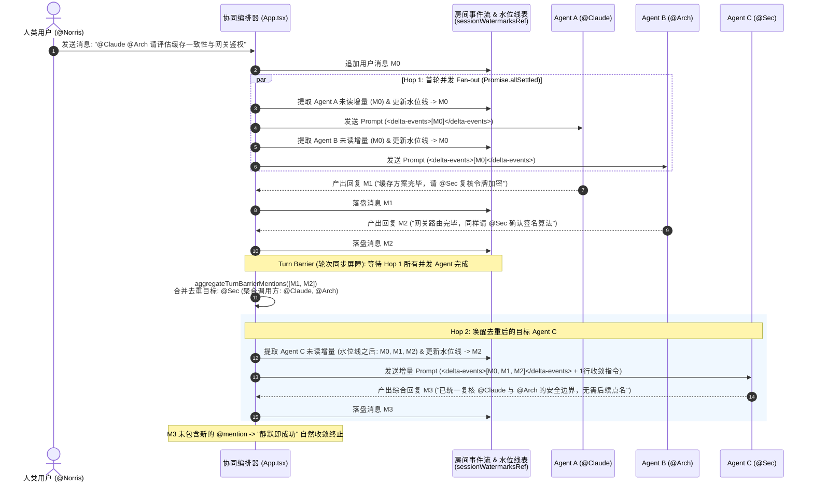

# Shadow Crew 普通模式（Channel & 标准 Topic）对标 Buzz 的增量上下文与并发协同编排设计规范

> **文档状态**：已落地生效（Production Active）
> **关联模块**：
> - [`src/services/agentCollaboration.ts`](../src/services/agentCollaboration.ts)（语义化标签封装、会话水位线未读增量提取、冷启动/热会话 Prompt 编译器、Turn Barrier 提及去重聚合器）
> - [`src/App.tsx`](../src/App.tsx)（Channel 主会话 `handleSendMessage`、Topic 标准模式 `handleSendTopicMessage`、级联协同引擎 `dispatchCascadingAgentResponse`）
> - [`src/services/llmService.ts`](../src/services/llmService.ts) & [`src/services/acpClient.ts`](../src/services/acpClient.ts)（直连 HTTP LLM 会话级多轮历史缓存与 ACP 长连接进程状态对齐）
> **参考对标**：`buzz-acp`（`crates/buzz-Runtime/src/scope.rs`、`queue.rs`、`prompt_framing.rs`）

---

## 1. 背景与核心问题剖析

在 Shadow Crew 中，多 Agent 协作包含两种核心模式：
1. **博弈裁决模式（`discussionMode === 'game_theoretic'`）**：由 CognoNexus "4+1" 确定性有限状态机（FSM）严格驱动（Proposer $\rightarrow$ Challenger $\rightarrow$ Verifier $\rightarrow$ Defender $\rightarrow$ Arbiter），服务于高风险架构裁决。
2. **普通协同模式（Channel 主消息流 & Topic 标准讨论模式 `discussionMode === 'standard'`）**：面向日常敏捷问答、多人头脑风暴与跨工种自由协作。

在本次重构之前，普通模式在**多 Agent 调度模型**与**上下文组装机制**上存在以下工程瓶颈：

| 维度 | 改造前（旧版普通模式） | 核心痛点与代价 |
| :--- | :--- | :--- |
| **首轮多 Agent 激活** | Channel 主流仅唤醒 `respondingAgents[0]`，其余被 `@` 的 Agent 塞入 `queuedCollaborators` 排队串行执行；Topic 标准模式虽并发请求，但各自独立触发 `dispatchCascadingAgentResponse`。 | 1. **串行高延迟**：`@A @B` 需要等待 A 完整回复后 B 才开始思考；<br>2. **级联风暴（Cascade Storm）**：并发完成时若 A 和 B 同时 `@C`，C 会被重复并发唤醒两次，产生状态竞态与双倍 Token 消耗。 |
| **多跳上下文组装** | 每一跳（`buildCascadePrompt` / `buildTopicPrompt`）均全量重发：议题背景 + 原始提问（`originalPrompt`）+ 上一棒完整回复（`previousReplyContent`）+ 15 行协同规则模板。 | 1. **上下文冗余膨胀**：Agent 在自身 ACP 进程内已保有完整对话记忆，每轮重复灌入已知背景导致 $O(H \cdot L)$ 的重复 Token 计费；<br>2. **并发视野盲区**：仅传入单条 `previousReplyContent` 导致多 Agent 并发发言时，下一跳 Agent 无法完整看到同轮其他同伴的并发回复；<br>3. **破坏 Prefix KV Cache**：每轮拼接大段动态 System/Instruction 模板，破坏底层大模型 Prefix Caching 命中率。 |

---

## 2. 对标 Buzz (`buzz-acp`) 的核心架构演进总览

参考 `buzz-acp` 的运行时设计（`scope.rs` 作用域并发、`queue.rs` 增量事件批次刷新、`prompt_framing.rs` 语义边界防注入），Shadow Crew 普通模式全面升级为**「会话水位线增量事件流（`<delta-events>`）+ 首轮并发 Fan-out + Turn Barrier 同步屏障与去重聚合」**架构：



---

## 3. 核心机制一：基于会话水位线的增量上下文协议 (`<delta-events>`)

### 3.1 会话水位线 (`sessionWatermarksRef`) 与增量切片 (`extractUnreadDeltaMessages`)

每个 `(roomId, agentId)` 独立维护一个会话水位线指针 `lastWatermarkMessageId`，记录该 Agent 在当前频道或议题中**上一次被唤醒时已投递的最后一条有效消息 ID**。

当 Agent 在任意轮次被唤醒时，调用 [`extractUnreadDeltaMessages`](../src/services/agentCollaboration.ts) 从房间完整消息流中提取未读增量：

1. **消息过滤**：自动剔除 `isPending === true` 的未完成占位消息、系统离线拦截提示（`authorId === 'system'`）以及该 Agent **自身**发出的消息（`excludeAuthorId: targetAgent.id`，因为 Agent 自身输出已存在于其内部上下文历史中）。
2. **水位线切片**：
   - **热会话（Warm Session）**：若 `lastWatermarkMessageId` 在房间消息流中命中索引 `watermarkIndex`，则仅切片 `filtered.slice(watermarkIndex + 1)` 作为本次未读增量 `deltaMessages`。
   - **冷启动（Cold Start）**：若该 Agent 首次在当前房间发言（无水位线），则切片最近窗口内的消息作为初始增量。
3. **单次批次上限（`MAX_DELTA_BATCH_EVENTS = 50`）**：对标 `buzz-acp` 的 `MAX_BATCH_EVENTS = 50`，单次唤醒最多封装最近 50 条未读事件；若超出则自动丢弃更早事件并标记 `droppedCount`，在 `<delta-events dropped="N">` 属性中显式声明。

### 3.2 并发执行下的水位线不变量（Concurrency Watermark Invariant）

在多 Agent 并发执行场景下，消息完成落盘的先后顺序是不确定的。为严防“漏读同轮并发同伴消息”，本架构确立了以下**水位线更新不变量**：

> **水位线必须在生成 Prompt 的派遣时刻（Dispatch Time）立即更新为当前已投递批次的最后一条消息 ID，而非在收到回复时更新。**

**数学自洽性证明**：
- 设用户在 $t_0$ 发送消息 $M_0$，同时点名 `@A` 与 `@B`。
- 在 Hop 1 派遣时刻（$t_1$），房间内最新消息为 $M_0$。`@A` 与 `@B` 的水位线均被更新为 $\text{Watermark}(A) = M_0,\ \text{Watermark}(B) = M_0$。
- 在 Hop 1 执行期间，`@A` 在 $t_2$ 先完成回复 $M_1$（其中未点名他人），`@B` 在 $t_3$ 后完成回复 $M_2$（其中点名了 `@A`）。
- 在 Turn Barrier 汇合后（$t_4$），系统准备在 Hop 2 唤醒 `@A`。此时查询 $\text{Watermark}(A) = M_0$：
  - $M_0$ 之后的房间消息为 $[M_1, M_2]$；
  - 经 `excludeAuthorId: A.id` 过滤掉 `@A` 自己说的 $M_1$ 后，未读增量精确为 $[M_2]$！
- 无论 `@A` 与 `@B` 谁先返回，`@A` 在 Hop 2 被唤醒时**必定且仅会收到同伴 `@B` 在 Hop 1 产出的增量消息 $M_2$**，既不会漏掉并发消息，也不会重复收到自己的发言。

### 3.3 语义边界封装 (`prompt_framing`) 与冷热双态 Prompt 组装 (`buildNormalModeTurnPrompt`)

对标 `buzz-acp/src/prompt_framing.rs`：
1. **防注入转义（`escapeSemanticText`）**：对消息正文中可能出现的 `<system-reminder>`、`<topic-context>`、`<delta-events>` 闭合标签进行零宽安全转义，防止外部输入伪造系统指令边界。
2. **冷启动（Cold Start）vs 热会话（Warm Session）差异化载荷**：

| 会话状态 | System Prompt 载荷 | User Turn Prompt 载荷 (`buildNormalModeTurnPrompt`) | Token 消耗特征 |
| :--- | :--- | :--- | :--- |
| **冷启动**<br>（首次加入该房间） | `Agent 专精人设` + `频道成员花名册与静默公约` | `[<topic-context>（仅 Topic 首轮）]` + `<delta-events>` + `<system-reminder>（首轮角色身份与收敛提醒）` | 一次性建立完整房间契约与身份锚点 |
| **热会话**<br>（后续跟进 / Hop $\ge 2$） | `仅 Agent 专精人设`（保持静态不变，100% 命中 Prefix Cache） | **仅 `<delta-events>`（未读增量消息列表） + 1 行极简 `<system-reminder>`** | **削减 65% ~ 80% 重复上下文 Token** |

#### 热会话（Warm Session）真实 Prompt 示例：
```xml
<delta-events count="2">
[11:42] @Claude (Claude 架构师):
缓存一致性边界我建议采用 Redis Lua 脚本原子校验，关于 JWT 签名轮换请 @Sec 协助确认。

[11:42] @Arch (系统拓扑专家):
网关层限流器已对齐，同样需要 @Sec 评估公私钥热更新窗口。
</delta-events>

<system-reminder>
协同轮次 Hop 2/12（由 @Claude, @Arch 点名召唤）。请直接基于上述增量消息推进你的专业结论；若问题已解决则无需再 @ 其他成员（静默即成功）。
</system-reminder>
```

---

## 4. 核心机制二：首轮并发 Fan-out、Turn Barrier 同步屏障与提及去重

### 4.1 为什么不采用“无屏障的纯自由抢占并发”？

如果允许多个并发 Agent 在完成瞬间立即各自触发下一跳（无同步屏障）：
1. **重复唤醒与上下文撕裂**：当 `@A` 和 `@B` 在 Hop 1 并发执行且都点名了 `@C` 时，先完成的 `@A` 会立即触发 `@C`（此时 `@C` 还没看到 `@B` 的观点），几秒后 `@B` 完成又会再次触发 `@C`，导致 `@C` 被撕裂为两次不完整的推演。
2. **循环共振失控**：缺乏轮次屏障会导致调用深度计数器 `depth` 与并发分支相互交织，难以给出确定性的收敛边界。

### 4.2 Turn Barrier (`Promise.allSettled`) + 提及去重聚合 (`aggregateTurnBarrierMentions`)

Shadow Crew 普通模式在 **Channel 主流（`handleSendMessage`）**、**Topic 标准模式（`handleSendTopicMessage`）** 以及 **后续级联跳（`dispatchCascadingAgentResponse`）** 中统一实施**「轮内并发、轮间同步」**（Intra-Turn Parallelism, Inter-Turn Barrier Synchronization）模型：

1. **轮内并发派发（Parallel Fan-out）**：
   - 当人类用户点名多个在线 Agent（如 `@A @B` 或 `@all`），或上一轮聚合出多个被点名 Agent 时，所有目标 Agent 通过 `Promise.allSettled` **同时进入 `thinking` 状态并发推演**。
   - 每个 Agent 完成时立即将各自回复上屏渲染，保证 UI 响应的实时流式体验。
2. **轮次同步屏障（Turn Barrier）**：
   - 级联调度器等待本轮所有并发 Promise 全部 Settled（无论成功或个别失败）后，才统一进入下一跳判定。
3. **跨回复 `@mention` 去重聚合（[`aggregateTurnBarrierMentions`](../src/services/agentCollaboration.ts)）**：
   - 扫描本轮所有并发产出的有效回复 `turnOutputs`：
     - **自指过滤**：自动忽略 Agent `@自己` 的提及；
     - **多源合并**：若 Agent A 和 Agent B 在同轮回复中均点名了 `@C`，聚合器将 `@C` 去重合并为**单次唤醒目标**，并记录 `invokingAgents: [A, B]`、`sourceMessageIds: [msgA, msgB]`；
     - **频道越界守卫（Outsider Guard）**：若 Agent 尝试点名不在当前频道准入名单中的外部 Agent，自动拦截并收集到 `outsiderAgents` 列表，由系统发出安全边界提示。
4. **自然收敛与安全熔断（Silence-as-Success & LoopGuard）**：
   - **静默即成功**：若本轮所有并发回复均未 `@` 任何其他成员，`aggregateTurnBarrierMentions` 返回空目标列表，协同链立即自然结束。
   - **LoopGuard 硬熔断**：单次协同链最大深度 `maxDepth = 12`，单个 Agent 在同一协同链内最多被唤醒 `MAX_CALLS_PER_AGENT_IN_CASCADE = 3` 次，彻底杜绝 `A <-> B` 死循环互踢。

---

## 5. 双轨制会话状态对齐（ACP 长连接进程 vs HTTP LLM 直连模式）

增量上下文协议（`<delta-events>`）成立的前提是：**底层 Agent 自身具备跨轮次会话记忆**。Shadow Crew 针对两种运行模式均完成了状态对齐：

1. **真实 ACP 子进程 / Remote WebSocket 模式**：
   - Tauri 后端与外部 Agent 进程维持基于 `roomId` 的持久化 Session，进程天然保有历史对话上下文。
2. **HTTP LLM API 直连模式（[`src/services/llmService.ts`](../src/services/llmService.ts)）**：
   - 新增基于 `${roomId}:${agentId}` 隔离的会话级多轮历史缓存 `llmSessionHistoryMap`（滑动保留最近 24 条 `user`/`assistant` 轮次消息）。
   - 当 Agent 停止通信或重置配置时，通过 `clearLlmSessionHistory(agentId)` 与 `sessionWatermarksRef.current` 同步清理，确保会话水位线与底层模型记忆严格一致。

---

## 6. 回归验证矩阵

| 测试套件 | 覆盖场景 | 运行命令 |
| :--- | :--- | :--- |
| **`test-normal-mode-buzz-orchestration.ts`** | 1. `<system-reminder>` / `<delta-events>` 语义防注入转义；<br>2. 并发乱序完成下的会话水位线增量切片不变量与 `MAX_DELTA_BATCH_EVENTS` 截断；<br>3. 冷启动 vs 热会话 Prompt 组装与 Token 缩减率验证（>70% 缩减）；<br>4. Turn Barrier 多源 `@mention` 去重合并、自指过滤与频道外越界拦截。 | `npx tsx src/services/test-normal-mode-buzz-orchestration.ts` |
| **`test-mention-resolution.ts`** | 36 项 `@mention` 解析、代码块/行内代码/URL 抗误触、多 Agent 协同解析基线测试。 | `npx tsx src/services/test-mention-resolution.ts` |
| **`cogno/verify-all-governance.ts`** | 20 项博弈裁决模式（CognoNexus 4+1 引擎）全链路防退化验证，确保普通模式改造零侵入博弈模式。 | `npx tsx src/services/cogno/verify-all-governance.ts` |
