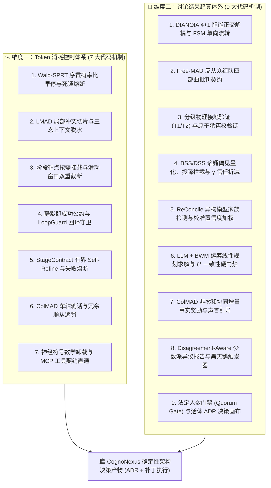

# 🥷 Shadow Crew (CognoNexus) 博弈论多 Agent 系统：Token 消耗控制与决策准确性保障技术报告
## —— 代码架构设计、数学控制模型与前沿学术论文支撑全景梳理

> **文档编号**：`TECH_REPORT_GAME_THEORETIC_TOKEN_AND_ACCURACY_GOVERNANCE`  
> **版本**：v2.1.0 (CognoNexus Neuro-Symbolic Governance)  
> **关联文档**：
> - [`SPEC_GAME_THEORETIC_ORCHESTRATION_PROTOCOL.md`](file:///Users/xunuosi/Code/Lx/AI/shadow-crew/docs/SPEC_GAME_THEORETIC_ORCHESTRATION_PROTOCOL.md)
> - [`PRD_MULTI_AGENT_DECISION_ACCURACY_GOVERNANCE.md`](file:///Users/xunuosi/Code/Lx/AI/shadow-crew/docs/PRD_MULTI_AGENT_DECISION_ACCURACY_GOVERNANCE.md)
> - [`Localized Multi-Agent Debate for Multi-Hop Question Answering.md`](file:///Users/xunuosi/Code/Lx/AI/shadow-crew/docs/Localized%20Multi-Agent%20Debate%20for%20Multi-Hop%20Question%20Answering.md)

---

## 0. 摘要与核心背景

在工业级软件研发场景中，传统多智能体辩论（Multi-Agent Debate, MAD）普遍面临两大核心瓶颈：

1. **Token 消耗失控与上下文灾难（Token Explosion & Context Pollution）**：
   - 传统多 Agent 采用固定轮次（Fixed-Round）全量广播聊天，Token 消耗随智能体数量 $N$、轮次 $R$ 与单轮文本长度 $L$ 呈 $O(N^2 \cdot R \cdot L)$ 级联膨胀；
   - 智能体之间频繁出现社交客套（“收到/非常同意”）、车轱辘话复读、死循环拉锯以及盲目调用本地搜索工具空转。
2. **讨论结果失真与群体智降（Groupthink & Hallucination Cascade）**：
   - **从众与谄媚级联**：受 RLHF 礼貌对齐训练影响，大模型面对红队强力反驳时极易发生“无原则认错投降”，或向错误多数派妥协；
   - **一致性幻觉（Consistency Illusion）**：多个同质化模型虽然表面结论一致，但底层推理前提相互矛盾或未经物理工具验证；
   - **自然语言裁决漂移**：依赖单一裁判 LLM 用感性自然语言总结陈词，容易产生尺度偏置、遗漏少数派关键预警或输出截断乱码。

为彻底攻克上述两大难题，**Shadow Crew (CognoNexus 引擎)** 深度融合 **10 篇多智能体与运筹学前沿论文**，在代码主链路中实装了 **7 大 Token 降本控制机制** 与 **9 大讨论结果趋真保障机制**，实现了“算力受控”与“真理收敛”的神经符号（Neuro-Symbolic）双闭环。



---

## 一、保证 Token 消耗量不过大的代码设计（7 大工程机制）

### 1.1 Wald-SPRT 序贯概率比自适应动态早停与死锁熔断
* **学术论文支撑**：
  * **Wald-SPRT Compute Governor** (*arXiv:2605.19193*)：在多 Agent 架构外围构建序贯概率比检验计算调控层，解决固定轮次辩论造成的算力浪费，在保持准确率前提下最高缩减 **3.7 倍** 模型调用量。
  * **Wald, A. (1945)** (*Sequential tests of statistical hypotheses, Annals of Mathematical Statistics*)。
* **核心代码实现**：
  * [`src/services/cogno/sprtComputeGovernor.ts`](file:///Users/xunuosi/Code/Lx/AI/shadow-crew/src/services/cogno/sprtComputeGovernor.ts)：`stepSprtGovernor()`、`fitSprtCalibrationParams()`、`estimateRoundAlignmentScore()`
  * [`src/services/cogno/metricBaselineTracker.ts`](file:///Users/xunuosi/Code/Lx/AI/shadow-crew/src/services/cogno/metricBaselineTracker.ts)：`getMetricBaselineSummary()`
  * [`src/App.tsx`](file:///Users/xunuosi/Code/Lx/AI/shadow-crew/src/App.tsx)：阶段迁移时实时消费 `sprtState.decisionState`
* **代码设计细节**：
  1. **似然比累积方程**：摒弃固定轮次循环，在每阶段结束时评估多维对齐分 $S_r \in [0.05, 0.95]$，计算当轮对数似然比增量并累加：
     $$\Delta \Lambda_r = \text{sensitivity} \times (S_r - 0.50), \quad \Lambda_r = \Lambda_{r-1} + \Delta \Lambda_r$$
  2. **双阈值动态门禁**：依据第一类错误率 $\alpha$（虚假早停）与第二类错误率 $\beta$（死锁误判，默认 $\alpha=\beta=0.05$）计算上下界：
     $$A = \ln\left(\frac{1 - \beta}{\alpha}\right) \approx +2.944, \quad B = \ln\left(\frac{\beta}{1 - \alpha}\right) \approx -2.944$$
  3. **三态算力截流**：
     - **高置信早停（`early_exit`）**：当 $\Lambda_r \ge A$（且不存在未实证的核心争议点）或达到安全轮次上限 `maxRounds = 4` 时，立即判定已达成高质量收敛，跳过后续冗余拉锯轮次，直接转入终局仲裁；
     - **病态死锁熔断（`deadlock_escalation`）**：当 $\Lambda_r \le B$ 时，判定智能体陷入底层价值冲突死锁，立即熔断自动级联并推送人类澄清卡片，杜绝死循环空耗 Token；
     - **动态基线校准（R-4）**：`fitSprtCalibrationParams()` 根据本地历史议题的人工介入率（`humanInterventionRate`）与自动裁定率（`autoArbitrationRate`），在 `[2.8, 4.5]` 区间自适应拟合 `sensitivity` 与 $\alpha, \beta$。

---

### 1.2 LMAD 局部冲突切片定位与三态上下文脱水折叠（Context Dehydration）
* **学术论文支撑**：
  * **LMAD** (*Localized Multi-Agent Debate for Multi-Hop Question Answering, arXiv:2608.01463*)：将长链推导拆解为离散论点节点图谱（Claim DAG），在最早发生分歧的局部切片内定向修补，并冻结已确认节点状态，消除全量长文本累积造成的上下文污染与 Token 膨胀。
* **核心代码实现**：
  * [`src/services/cogno/lmadConflictLocalizer.ts`](file:///Users/xunuosi/Code/Lx/AI/shadow-crew/src/services/cogno/lmadConflictLocalizer.ts)：`extractArgumentNodes()`、`buildArgumentDag()`、`localizeGraphDiffDispute()`、`dehydrateContextWithAlert()`
* **代码设计细节**：
  1. **去空壳 Top-5 核心论点抽取**：
     - 使用 `SHELL_PREFIX_REGEX` 与 `BOILERPLATE_HEADING_REGEX` 剥离“综上所述/架构总览”等无实义导语；
     - 强制校验 `ASSERTION_VERB_REGEX`（必须包含“采用/引入/保证/熔断/解耦”等实质架构动词）；
     - **硬性容量上限**：单篇长文最多抽取 **5 个**核心技术主张节点（`if (nodes.length >= 5) break`，单条长度严格限制在 `10 ~ 160` 字符）。
  2. **图差分根源冲突切片（`DisputeSpanPacket`）**：
     - `localizeGraphDiffDispute()` 在有向无环图（Claim DAG）上逆向溯源，定位最早被红队攻破的根源节点 `rootDisputeNodeId` 及其下游受影响子图 `affectedSubgraphNodeIds`，后续阶段仅针对该冲突切片交锋。
  3. **三态事实脱水折叠（`supported | disputed | refuted`）**：
     - `dehydrateContextWithAlert()` 将未被挑战或已验证通过的论点标记为 `supported` 并沉淀至不可变的 `committedStates` 事实看板，无需在后续轮次中反复重传数千字的原始论证过程。

---

### 1.3 阶段靶点按需挂载与历史滑动窗口双重截断
* **学术论文支撑**：
  * **LMAD** (*arXiv:2608.01463*) & **DIANOIA** (*arXiv:2602.08586*)：通过信息通道隔离，确保每个智能体仅接收与其当前职能直接相关的最小充分上下文（Minimal Sufficient Context）。
* **核心代码实现**：
  * [`src/App.tsx`](file:///Users/xunuosi/Code/Lx/AI/shadow-crew/src/App.tsx)：`triggerTopicExecution()`（第 4208–4240 行）
  * [`src/services/agentCollaboration.ts`](file:///Users/xunuosi/Code/Lx/AI/shadow-crew/src/services/agentCollaboration.ts)：`buildTopicPrompt()`、`buildRelayPrompt()`
* **代码设计细节**：
  1. **双重滑动窗口截断（4 条 × 300 字）**：
     - 在 `App.tsx` 中提取议题历史时，先过滤掉系统提示与守卫消息，再执行 `.slice(-4)` 仅保留最近 4 条发言；
     - 在 `buildTopicPrompt()` 中，对每条历史记录执行 `h.content.length > 300 ? `${h.content.slice(0, 300)}...` : h.content`，将历史脉络背景严格锁定在 **1200 字符（约 600~800 Tokens）** 以内。
  2. **FSM 阶段靶点按需挂载**：
     - `challenge` 阶段仅挂载 `targetProposalText`；
     - `verification` 阶段挂载 `targetProposalText` + `targetChallengeText`；
     - 彻底杜绝将整个频道上百条历史消息无脑塞入 Prompt。
  3. **接力提示词去公约复读**：`buildRelayPrompt()` 遵循“不复读 30 行系统级平台公约”原则，仅传递纯净的接力诉求与单行协同提示，大幅压缩 System Prompt 开销。

---

### 1.4 “静默即成功”协同公约与 LoopGuard 回环静默守卫
* **学术论文支撑**：
  * **ColMAD** (*arXiv:2510.20963*)：抑制多智能体博弈中的“廉价对话（Cheap Talk）”与无效社交回合。
* **核心代码实现**：
  * [`src/services/agentCollaboration.ts`](file:///Users/xunuosi/Code/Lx/AI/shadow-crew/src/services/agentCollaboration.ts)：`buildCrewRosterGuidance()`、`checkLoopGuard()`、`extractMentionedAgents()`
* **代码设计细节**：
  1. **增量信息价值准则（Information Delta）**：在协同公约中立下铁律——唯有提供实质性、非显而易见的技术增量时才允许 `@handle` 接力；达成共识时**严禁 `@` 任何成员**，不含 `@handle` 即代表协同自然收敛结题（Silence as Success）。
  2. **严禁本地工具盲搜其他 Agent**：明确禁止 Agent 在自身沙箱中调用 `sessions_list`、`bash grep/find` 等工具去探测其他 Agent，阻断因工具盲搜导致的数万 Token 浪费与超时。
  3. **叙述性提及防误触**：区分“召唤接力（加 `@`）”与“叙述引用（直接写名字不加 `@`）”，防止因礼貌提及他人姓名而误触发新一轮 Agent 唤醒。
  4. **回环静默守卫（`checkLoopGuard`）**：设置级联深度上限 `cascade.maxDepth` 与单链单 Agent 响应上限（`< 8` 次），触顶时采用 `isSilentEnd: true` 静默终止级联，不产生额外告警风暴。

---

### 1.5 阶段契约有界自修正与失败硬熔断（Bounded Self-Refine Gate）
* **学术论文支撑**：
  * **Free-MAD** (*arXiv:2509.11035*) & **ColMAD** (*arXiv:2510.20963*)：通过前置结构化契约拦截低信息量敷衍输出，防止劣质文本流入下游引发整条多 Agent 链路重算。
* **核心代码实现**：
  * [`src/services/cogno/stageContractGate.ts`](file:///Users/xunuosi/Code/Lx/AI/shadow-crew/src/services/cogno/stageContractGate.ts)：`validateStageContract()`、`STAGE_CONTRACT_MAX_RETRIES = 2`
* **代码设计细节**：
  1. **零 Token 本地预检**：在宿主前端用确定性规则即时校验 Agent 输出（拦截 `< 30` 字短评、“好的/收到/我同意”等裸确认，以及缺失阶段要素的回复）。
  2. **原位阻断防扩散**：一旦某阶段输出未达标，立即原位挂起 FSM 状态机，绝不唤醒下游的 2~3 个角色 Agent，仅对当前违规 Agent 下发定向 `refinePrompt`。
  3. **有界重试硬熔断**：严格限定 `STAGE_CONTRACT_MAX_RETRIES = 2`。若连续 2 次 Self-Refine 仍不合格，立即将议题置为 `stageFailed` 并移交人类，杜绝异常模型陷入无限重试黑洞。

---

### 1.6 ColMAD 车轱辘话与冗余顺从惩罚机制
* **学术论文支撑**：
  * **ColMAD** (*Collaborative Multi-Agent Debate, arXiv:2510.20963*)：通过负向惩罚抑制重复复读与无意义套话。
* **核心代码实现**：
  * [`src/services/cogno/colmadGovernor.ts`](file:///Users/xunuosi/Code/Lx/AI/shadow-crew/src/services/cogno/colmadGovernor.ts)：`calculateColMadContributions()`
* **代码设计细节**：
  - 内置 `REDUNDANT_BOILERPLATE` 冗余词库（“总的来说”、“正如前面所说”、“如前所述”、“我再次重申”、“非常同意”等）及空洞顺从检测；
  - 每次命中累加 `redundantPenalty`，并在协同事实得分中执行 $-1.5 \times \text{RedundantPenalty}$ 惩罚扣分，低于 0 分直接打上 `⚠️ 冗余 (redundant)` 声誉标签；
  - 对同一边界关键词设置 `Math.min(2, matches.length)` 封顶，彻底废除靠“堆砌字数与刷关键词”骗取权重的空间。

---

### 1.7 神经符号计算卸载与 MCP 工具契约直通（Neuro-Symbolic Offloading）
* **学术论文支撑**：
  * **LLM + BWM** (*Applied Sciences, 2026*)：将大模型的定性语义能力与运筹学确定性数学求解解耦，用本地数值优化替代多轮自然语言争辩。
* **核心代码实现**：
  * [`src/services/cogno/mcdaDeterministicSolver.ts`](file:///Users/xunuosi/Code/Lx/AI/shadow-crew/src/services/cogno/mcdaDeterministicSolver.ts)：`solveExactBwmOptionB()`
  * [`crates/shinobi-dev-mcp/src/tools/mod.rs`](file:///Users/xunuosi/Code/Lx/AI/shadow-crew/crates/shinobi-dev-mcp/src/tools/mod.rs)：`submit_arbitration_ruling`
  * [`src/services/acpClient.ts`](file:///Users/xunuosi/Code/Lx/AI/shadow-crew/src/services/acpClient.ts)：`extractArbitrationRulingFromAcpResponse()`
* **代码设计细节**：
  1. **0 Token 运筹学求解**：多属性权重分配与效用排序完全卸载到本地 TypeScript 实现的 BWM 线性规划求解器（2000 次单纯形欧氏投影迭代耗时 $< 5\text{ms}$，消耗 **0 Token**），无需让多个 Agent 为了权衡比例反复争吵。
  2. **Tool-as-Contract 一次成型**：综合仲裁官在阶段 5 直接调用宿主 Rust MCP 工具 `submit_arbitration_ruling` 提交类型安全的裁决书草案（`decision_type`, `summary`, `trade_off_points`, `impacted_files`, `solution`），免去了宿主额外调用总结模型二次清洗的 Token 开销。

---

## 二、保证讨论结果趋向正确的代码设计（9 大工程机制）

### 2.1 DIANOIA 4+1 职能正交解耦与有限状态机（FSM）单向强约束
* **学术论文支撑**：
  * **DIANOIA** (*arXiv:2602.08586*)：将多智能体协作收益严谨分解为**探索增益（$\mathcal{G}_{\text{explore}}$）**、**信息增益（$\mathcal{G}_{\text{info}}$）**与**聚合增益（$\mathcal{G}_{\text{aggr}}$）**三个正交通道，证明职能专一化与外部环境接地是达到帕累托最优边界的先决条件。
* **核心代码实现**：
  * [`src/types.ts`](file:///Users/xunuosi/Code/Lx/AI/shadow-crew/src/types.ts)：`GameTheoreticStage`、`GameRoleType`、`GameRolesConfig`
  * [`src/services/agentCollaboration.ts`](file:///Users/xunuosi/Code/Lx/AI/shadow-crew/src/services/agentCollaboration.ts)：`getAgentGameRole()`、`buildTopicPrompt()`
* **代码设计细节**：
  - 将参与角色正交解耦为：
    1. 🏛️ **提案官（Proposer）**：负责 $\mathcal{G}_{\text{explore}}$，探索解空间并输出立论方案与后续架构防御补丁（Patch v2）；
    2. ⚔️ **红队对抗官（Challenger）**：负责压力测试与边界反例挖掘；
    3. 🔍 **接地验证官（Verifier）**：负责 $\mathcal{G}_{\text{info}}$，不参与主观辩论，专职调用物理工具验证可证伪断言；
    4. ⚖️ **中立综合官（Arbiter）**：负责 $\mathcal{G}_{\text{aggr}}$，提炼权衡矩阵并提交结构化裁决草案；
    5. 👤 **人类首席仲裁官（Human Arbiter）**：持有终审法槌与安全宪章签署权。
  - 状态机严格按 `proposal → challenge → verification → defense → arbitration → concluded` 推进，从架构上根除无序群聊的“先入为主锚定效应（Cognitive Anchoring）”。

---

### 2.2 Free-MAD 去共识化红队四部曲批判契约
* **学术论文支撑**：
  * **Free-MAD** (*Consensus-Free Multi-Agent Debate, arXiv:2509.11035*)：揭示传统辩论以“达成共识”为目标会诱导早期拥有正确观点的模型向错误多数派妥协；提出“去共识化（Consensus-Free）”对抗框架。
* **核心代码实现**：
  * [`src/services/agentCollaboration.ts`](file:///Users/xunuosi/Code/Lx/AI/shadow-crew/src/services/agentCollaboration.ts)：阶段 2 红队对抗指令
  * [`src/services/cogno/stageContractGate.ts`](file:///Users/xunuosi/Code/Lx/AI/shadow-crew/src/services/cogno/stageContractGate.ts)：`validateStageContract()` 中 `challenge` 分支
* **代码设计细节**：
  - **强制黑帽反从众**：Prompt 明确下达“严禁盲目附和或客套赞同！你的唯一职责是挖掘逻辑漏洞与极端失效场景”。
  - **四部曲结构化门禁**：`stageContractGate.ts` 硬性校验红队输出必须覆盖：① 逻辑矛盾/风险缺陷、② 隐含脆弱假设、③ 极端边缘失效场景（高并发/断网/抖动/脏数据）、④ 反例与实证检验要求（至少命中 2 个核心维度且篇幅 $\ge 70$ 字，否则拦截重做）。

---

### 2.3 分级物理接地验证（T1/T2）、原子承诺校验链与未实证早停硬锁
* **学术论文支撑**：
  * **DIANOIA** (*arXiv:2602.08586*)：证实外部物理执行环境是打破纯文本辩论天花板的必要条件。
  * **Consistency Illusion / GDP** (*Grounded Debate Protocol, arXiv:2606.08457*)：发现多 Agent“结论一致但推理冲突”的一致性幻觉，提出强制绑定实证证据的**原子级承诺校验（Atomic Commitment Verification）**。
* **核心代码实现**：
  * [`src/services/cogno/tieredGroundingGovernor.ts`](file:///Users/xunuosi/Code/Lx/AI/shadow-crew/src/services/cogno/tieredGroundingGovernor.ts)：`executeGroundingTool()`、`parseVerifierOutput()`、`processVerifierEvidenceChain()`、`clampEvidenceWeight()`
  * [`src/services/cogno/sprtComputeGovernor.ts`](file:///Users/xunuosi/Code/Lx/AI/shadow-crew/src/services/cogno/sprtComputeGovernor.ts)：`hasUnverifiedCriticalDispute` 硬门禁
* **代码设计细节**：
  1. **T1 / T2 工具分级与权重钳制（R-3）**：
     - **T1 只读建议级工具**（`rag_search`, `static_analyzer`, `ast_grep`, `read_file`, `git_diff_summary`, `cargo_clippy`）：显式打标 `isAdvisory: true`，证据权重通过 `clampEvidenceWeight()` 硬性封顶在 **`[0.05, 0.30]`**，防止静态文本匹配篡夺最终裁决权；
     - **T2 物理沙箱执行级工具**（`code_sandbox`, `sql_executor`, `bash_exec`, `write_file`）：权重可达 **`1.0`**，但默认处于硬冻结状态；唯有当人类签署《安全宪章》（`isSafetyCharterSigned === true`）时才允许放行，且全量记入 `AuditLedger` 审计账本。
  2. **原子级承诺校验链（Atomic Commitment Chain）**：
     - `processVerifierEvidenceChain()` 将解析出的每条 `GroundingEvidence` 的 `evidenceId` 绑定到对应论点节点 `ArgumentNode.evidenceRefs`；
     - 一旦任意关联实证返回 `truthValue === false`，该论点状态立即从 `supported/disputed` 降级为 **`refuted`（已证伪）**，并在加权真值率 `weightedTrueRatio` 中实时体现。
  3. **未实证早停硬锁（Anti-Premature Exit Lock）**：
     - 在 `stepSprtGovernor()` 中，即便两造文字看似高度一致使似然比 $\Lambda_r \ge A$，只要 `hasUnverifiedCriticalDispute === true`，系统强制将决策状态锁定为 `'continue'`，逼迫流程必须经过接地验证官的物理实测。

---

### 2.4 Sycophancy Propagation 谄媚偏见量化（BSS/DSS）、投降拦截与 $\gamma$ 信任折减
* **学术论文支撑**：
  * **Sycophancy Propagation** (*arXiv:2604.02668*)：实证了谄媚偏见在多 Agent 讨论中的级联放大效应，提出静态先验谄媚度（BSS）与动态行为谄媚度（DSS）评分及权重衰减机制，使决策准确率提升 **10.5 个百分点**。
  * **Sharma, M., et al. (2023)** (*Towards Understanding Sycophancy in Language Models*).
* **核心代码实现**：
  * [`src/services/cogno/sycophancyGovernor.ts`](file:///Users/xunuosi/Code/Lx/AI/shadow-crew/src/services/cogno/sycophancyGovernor.ts)：`estimateBaselineSycophancyScore()`、`evaluateDynamicSycophancyScore()`、`detectSycophanticSurrender()`、`applySycophancyDiscountToSprt()`
* **代码设计细节**：
  1. **静态先验谄媚档案（BSS）**：根据 Agent 绑定的底层模型自动建立先验基线：
     - 深度推理模型（`o1 / o3 / r1 / reasoner`）：$\text{BSS} = 0.18$（逻辑坚定，极少盲从）；
     - 旗舰通用模型（`claude-3.7 / gpt-4o / deepseek-v3 / gemini-2.5-pro`）：$\text{BSS} = 0.32$；
     - 轻量/端侧蒸馏模型（`mini / flash / 7b / 8b / ollama`）：$\text{BSS} = 0.55$（面对强对抗易退让）。
  2. **动态行为谄媚分（DSS）与全盘投降拦截**：
     - 对照 20 类顺从认错短语（`SYCOPHANTIC_PHRASES`，如“确实是我考虑不周/我收回之前的方案/完全听从您的指导”）与 19 类硬核技术防御特征（`AUTHENTIC_DEFENSE_PHRASES` + 代码块检测）；
     - 若答辩阶段出现 $\ge 2$ 处认错妥协且无任何实质代码/架构补丁，`detectSycophanticSurrender()` 直接判定为 **`isSurrender: true`**，由阶段契约门禁硬性拦截并要求重写。
  3. **数学信任折减因子 $\gamma$ 与双路注入**：
     $$\gamma = 1 - \min\left(0.60,\; 0.40 \times \text{DSS} + 0.20 \times \text{BSS}\right) \in [0.40, 1.00]$$
     - **注入路一（SPRT 防伪早停）**：`applySycophancyDiscountToSprt()` 执行 $S_{\text{cal}} = S_{\text{raw}} \cdot \gamma + 0.50 \cdot (1 - \gamma)$，将因“商业吹捧/无脑认错”虚高的对齐分强制拉回中性值 $0.50$，阻止虚假共识早停；
     - **注入路二（MCDA 置信度融合）**：在多维融合公式 $S_r = 0.40 \cdot \text{GroundedRatio} + 0.35 \cdot \text{SemanticScore} + 0.25 \cdot (1 - \text{DSS})$ 及方案置信度矩阵中直接乘以 $\gamma$ 进行降权。

---

### 2.5 ReConcile 异构模型家族检测与校准置信度加权矩阵
* **学术论文支撑**：
  * **ReConcile** (*Round-Table Conference Improves Reasoning via Consensus among Diverse LLMs, ACL / arXiv:2309.13007*)：证明异构底层模型构成的圆桌讨论在推理多样性上显著优于同质模型多实例，并提出置信度加权机制。
* **核心代码实现**：
  * [`src/services/cogno/modelDiversityGovernor.ts`](file:///Users/xunuosi/Code/Lx/AI/shadow-crew/src/services/cogno/modelDiversityGovernor.ts)：`detectModelFamily()`、`calculateModelDiversity()`、`calculateConfidenceMatrix()`
* **代码设计细节**：
  1. **7 大模型家族异构度侦测**：自动识别 `anthropic`、`openai`、`deepseek`、`google`、`meta`、`qwen`、`local_other`。当参与博弈的所有角色背后指向单一模型家族（`distinctFamilyCount === 1`）时，系统将异构得分打降至 `0.25`（`isHomogeneous = true`），并在 UI 看板弹出 **⚠️ 同质化模型共识偏见警示（Homogeneous Model Bias Warning）**。
  2. **ReConcile 校准置信度矩阵（`confidenceMatrix`）**：
     - 摒弃静态硬编码置信度，结合接地验证结果动态校准：若存在物理证伪证据（`refutedCount > 0`），提案原案（方案 A）置信度下调 `-0.25`，红队方案（方案 B）上调 `+0.10`；若全部通过验证（`verifiedCount > 0`），方案 A 置信度上调 `+0.10`；
     - 最终乘以谄媚折减因子 $\gamma$，生成 $C_{i,j} \in [0.35, 1.00]$ 注入 BWM 效用方程。

---

### 2.6 LLM + BWM 神经符号确定性运筹求解与 $\xi^*$ 一致性硬门禁
* **学术论文支撑**：
  * **LLM + BWM** (*Applied Sciences, 2026*) & **Rezaei, J. (2015, 2016)** (*Best-worst multi-criteria decision-making method, Omega*)：融合大语言模型定性评估与运筹学最优最劣法（BWM），消除自然语言总结的随机漂移，并通过全局一致性指标 $\xi^*$ 检验决策逻辑传递性。
* **核心代码实现**：
  * [`src/services/cogno/mcdaDeterministicSolver.ts`](file:///Users/xunuosi/Code/Lx/AI/shadow-crew/src/services/cogno/mcdaDeterministicSolver.ts)：`solveExactBwmOptionB()`、`solveDeterministicBwm()`
  * [`src/services/agentCollaboration.ts`](file:///Users/xunuosi/Code/Lx/AI/shadow-crew/src/services/agentCollaboration.ts)：`generateDeterministicMcdaPayload()`
* **代码设计细节**：
  1. **真实研讨语料准则抽取与证据溯源（P0-3）**：
     - 从议题全文动态统计 6 大工程准则（系统健壮性 `rel`、吞吐性能 `perf`、实现复杂度 `comp`、数据一致性 `cons`、安全性 `sec`、资源成本 `cost`）的关切频次，筛选 Top-4 准则；
     - 结合实证检验真值与答辩补丁动态调整各方案评分，并记录每一项打分的审计溯源链 `scoreProvenance[alt][critId]`（例如 `"实证检验存在 2 项未通过/复现反例缺陷"`）。
  2. **BWM Option B 精确极小极大求解**：
     - 建立线性规划目标：
       $$\min \xi^L \quad \text{s.t.} \quad |w_B - a_{Bj} w_j| \le \xi^L, \quad |w_j - a_{jW} w_W| \le \xi^L, \quad \sum_{j=1}^n w_j = 1, \; w_j \ge 0$$
     - 采用解析几何均值种子 + 2000 步 Polyak 变步长次梯度下降 + 欧氏单纯形投影算法（`projectOntoSimplex`，Wang & Carreira-Perpiñán 2013）求解全局最优权重 $w^*$；
     - 综合效用函数融合方向归一化与 ReConcile 置信度矩阵：
       $$U(\text{alt}_i) = \sum_{j=1}^n w_j^* \cdot \hat{s}_{i,j} \cdot C_{i,j}$$
  3. **FLAT 退化拒绝与逻辑一致性硬门禁（R-1 / R-2）**：
     - 若输入偏好向量全为 1（无信息量退化），直接抛出 `insufficient_information` 拒绝；
     - 对照 `BWM_CONSISTENCY_INDEX_TABLE` 计算一致性比率 $CR = \xi^* / CI$，仅当 $CR \le 0.20$ 或 $\xi^* \le 0.12$ 时判定 `consistencyPassed = true`；否则在仲裁法槌弹窗中触发红色硬门禁，锁定普通定案按钮。

---

### 2.7 ColMAD 非零和协同增量事实奖励与声誉体系
* **学术论文支撑**：
  * **ColMAD** (*Collaborative Multi-Agent Debate, arXiv:2510.20963*)：将多 Agent 辩论从零和胜负博弈重构为非零和协同博弈，通过激励高信息量且具真值依据的增量事实陈述，使错误检测准确率提升最高 **10 个百分点**。
* **核心代码实现**：
  * [`src/services/cogno/colmadGovernor.ts`](file:///Users/xunuosi/Code/Lx/AI/shadow-crew/src/services/cogno/colmadGovernor.ts)：`calculateColMadContributions()`
* **代码设计细节**：
  - 定义非零和协同事实贡献奖励方程：
    $$\text{FactReward}_k = 2.0 \times \text{VerifiedClaims}_k + 2.5 \times \text{DiscoveredEdgeCases}_k - 1.5 \times \text{RedundantPenalty}_k$$
  - 自动统计各 Agent 贡献的“已验证主张数”与 23 类“极端边界工况（脑裂、并发击穿、死锁、重放攻击等）”，生成会话排行榜与四级声誉徽章（`🏆 先锋 pioneer`、`✓ 贡献 contributor`、`常规 neutral`、`⚠️ 冗余 redundant`），引导讨论向挖掘高价值边界事实收敛。

---

### 2.8 Disagreement-Aware 伴生《少数派异议报告》与黑天鹅重启触发器
* **学术论文支撑**：
  * **Disagreement-Aware Deliberation** (*arXiv:2606.04223*)：强调未被完全证伪的分歧是客观不确定性与工程风险的体现，不应被多数决或综合总结强制抹平，应作为结构化符号资产保留。
* **核心代码实现**：
  * [`src/services/cogno/minorityReportCompiler.ts`](file:///Users/xunuosi/Code/Lx/AI/shadow-crew/src/services/cogno/minorityReportCompiler.ts)：`compileMinorityReport()`
  * [`src/App.tsx`](file:///Users/xunuosi/Code/Lx/AI/shadow-crew/src/App.tsx)：在 Challenge 与 Arbitration 阶段自动编译并写入 `gameTheoreticState.minorityReport`
* **代码设计细节**：
  - 自动提取红队挑战者的核心保留立场（`coreDissentThesis`）与自洽逻辑依据（`rationalityBasis`）；
  - 根据争点语义（并发/网络/内存/安全）自动编制 **3 条量化的黑天鹅重启判定条件（`reopeningTriggers`）**（例如：“若生产环境高并发压测中 P99 延迟超过 250ms，须立即重启本议题”），随终局裁决书永久归档，防止激进架构风险被盲目掩盖。

---

### 2.9 人类法槌治理门禁（Quorum Gate）与活体 ADR 决策画布
* **学术论文支撑**：
  * **DIANOIA** (*arXiv:2602.08586*) 混合主动性（Mixed-Initiative）治理与软件工程 **Architecture Decision Record (ADR)** 规范。
* **核心代码实现**：
  * [`src/components/TopicThreadDrawer.tsx`](file:///Users/xunuosi/Code/Lx/AI/shadow-crew/src/components/TopicThreadDrawer.tsx)：法定人数门禁（Quorum Gate）、一致性门禁与人类具名豁免
  * [`src/components/LivingAdrCanvas.tsx`](file:///Users/xunuosi/Code/Lx/AI/shadow-crew/src/components/LivingAdrCanvas.tsx)：`LivingAdrCanvas`、`generateAdrMarkdown()`
  * [`crates/shinobi-dev-mcp/src/tools/mod.rs`](file:///Users/xunuosi/Code/Lx/AI/shadow-crew/crates/shinobi-dev-mcp/src/tools/mod.rs)：`submit_arbitration_ruling`
* **代码设计细节**：
  1. **制衡方缺席硬门禁（Quorum Gate）**：若红队挑战者因离线或超时未能产出有效反例（`isChallengerResponded === false`），系统禁止直接批准提案，强制要求人类首席仲裁官勾选风险承诺并录入具名豁免理由（`exemptionReason`）。
  2. **MCP 工具契约 + 活体 ADR 画布**：
     - 废除脆弱的前端正则截断，由综合仲裁官调用 `submit_arbitration_ruling` 工具提交结构化裁决书草案；
     - `LivingAdrCanvas` 将 **① 立论与 Claim DAG 拓扑、② 红队证伪与 LMAD 冲突切片、③ 接地实证清单、④ BWM 权衡矩阵与爆炸半径文件约束（`impactedFiles`）** 实时渲染为标准 ADR 画布，支持一键导出 `docs/adr/adr-xxx.md`，并直接驱动下游执行 Agent 实施精确的代码 Diff 补丁。

---

## 三、10 篇前沿论文与项目代码全景映射矩阵

| 序号 | 支撑论文 / 理论来源 | 论文核心发现与结论 | 工程作用维度 | 项目落地源码文件 | 核心函数 / 数据结构 |
| :--- | :--- | :--- | :--- | :--- | :--- |
| **1** | **Free-MAD**<br>(*arXiv:2509.11035*) | 传统“求共识”目标会激活模型从众本能，导致正确少数派向错误多数派妥协；需去共识化与全轨迹评估。 | 🎯 **保准确**<br>📉 **省 Token** | [`agentCollaboration.ts`](file:///Users/xunuosi/Code/Lx/AI/shadow-crew/src/services/agentCollaboration.ts)<br>[`stageContractGate.ts`](file:///Users/xunuosi/Code/Lx/AI/shadow-crew/src/services/cogno/stageContractGate.ts) | `validateStageContract()`<br>红队四部曲反从众批判契约、裸确认拦截与有界 `Self-Refine` (`MAX_RETRIES=2`) |
| **2** | **ColMAD**<br>(*arXiv:2510.20963*) | 将对抗辩论重构为非零和协同博弈，奖励具真值依据的增量事实，抑制“廉价对话”，错误检测率提升 10%。 | 🎯 **保准确**<br>📉 **省 Token** | [`colmadGovernor.ts`](file:///Users/xunuosi/Code/Lx/AI/shadow-crew/src/services/cogno/colmadGovernor.ts)<br>[`agentCollaboration.ts`](file:///Users/xunuosi/Code/Lx/AI/shadow-crew/src/services/agentCollaboration.ts) | `calculateColMadContributions()`<br>`ColMadSessionReport`、增量事实公式、车轱辘话惩罚与“静默即成功”公约 |
| **3** | **LMAD**<br>(*arXiv:2608.01463*) | 将长文推导拆解为离散节点图谱，在最早分歧点做局部切片修补并冻结已确认状态，准确率提升 7.2%。 | 📉 **省 Token**<br>🎯 **保准确** | [`lmadConflictLocalizer.ts`](file:///Users/xunuosi/Code/Lx/AI/shadow-crew/src/services/cogno/lmadConflictLocalizer.ts) | `extractArgumentNodes()` (Top-5 限制)<br>`buildArgumentDag()`<br>`localizeGraphDiffDispute()`<br>`dehydrateContextWithAlert()` |
| **4** | **Wald-SPRT Governor**<br>(*arXiv:2605.19193*) | 引入瓦尔德序贯概率比检验动态判定讨论充分性，实现自适应早停与死锁熔断，缩减 3.7 倍模型调用。 | 📉 **省 Token**<br>🎯 **保准确** | [`sprtComputeGovernor.ts`](file:///Users/xunuosi/Code/Lx/AI/shadow-crew/src/services/cogno/sprtComputeGovernor.ts)<br>[`metricBaselineTracker.ts`](file:///Users/xunuosi/Code/Lx/AI/shadow-crew/src/services/cogno/metricBaselineTracker.ts) | `stepSprtGovernor()`<br>`fitSprtCalibrationParams()`<br>`estimateRoundAlignmentScore()`<br>`SprtGovernorState` |
| **5** | **DIANOIA**<br>(*arXiv:2602.08586*) | 将多 Agent 增益分解为探索、信息、聚合三正交通道，证明引入外部物理执行环境是达到帕累托最优的前提。 | 🎯 **保准确**<br>📉 **省 Token** | [`types.ts`](file:///Users/xunuosi/Code/Lx/AI/shadow-crew/src/types.ts)<br>[`App.tsx`](file:///Users/xunuosi/Code/Lx/AI/shadow-crew/src/App.tsx)<br>[`tieredGroundingGovernor.ts`](file:///Users/xunuosi/Code/Lx/AI/shadow-crew/src/services/cogno/tieredGroundingGovernor.ts) | 4+1 角色正交架构 (`proposer`, `challenger`, `verifier`, `arbiter` + Human)<br>6 阶段 FSM 状态机与阶段靶点按需挂载 |
| **6** | **Sycophancy Propagation**<br>(*arXiv:2604.02668*) | 实证 RLHF 谄媚偏见在多 Agent 中的级联放大效应；提出 BSS/DSS 评分与权重衰减，准确率提升 10.5%。 | 🎯 **保准确**<br>📉 **省 Token** | [`sycophancyGovernor.ts`](file:///Users/xunuosi/Code/Lx/AI/shadow-crew/src/services/cogno/sycophancyGovernor.ts) | `estimateBaselineSycophancyScore()`<br>`evaluateDynamicSycophancyScore()`<br>`detectSycophanticSurrender()`<br>`applySycophancyDiscountToSprt()` |
| **7** | **Consistency Illusion / GDP**<br>(*arXiv:2606.08457*) | 揭示“结论一致但推理冲突”的一致性幻觉，提出接地辩论协议（GDP）与原子级承诺校验链。 | 🎯 **保准确** | [`tieredGroundingGovernor.ts`](file:///Users/xunuosi/Code/Lx/AI/shadow-crew/src/services/cogno/tieredGroundingGovernor.ts) | `processVerifierEvidenceChain()`<br>T1 ($\le 0.3$) / T2 安全宪章门禁、`ArgumentNode.evidenceRefs` 原子绑定与 `refuted` 自动降级 |
| **8** | **ReConcile**<br>(*ACL / arXiv:2309.13007*) | 证明异构模型家族圆桌讨论显著优于同质模型多实例，提出基于校准置信度的加权决策机制。 | 🎯 **保准确** | [`modelDiversityGovernor.ts`](file:///Users/xunuosi/Code/Lx/AI/shadow-crew/src/services/cogno/modelDiversityGovernor.ts)<br>[`llmService.ts`](file:///Users/xunuosi/Code/Lx/AI/shadow-crew/src/services/llmService.ts) | `detectModelFamily()`<br>`calculateModelDiversity()` (同质化偏见告警)<br>`calculateConfidenceMatrix()` |
| **9** | **LLM + BWM**<br>(*Applied Sciences, 2026* & *Rezaei 2015/2016*) | 结合 LLM 定性抽取与运筹学最优最劣法（BWM）线性规划求解，消除主观数值漂移，输出 $\xi^*$ 一致性校验。 | 🎯 **保准确**<br>📉 **省 Token** | [`mcdaDeterministicSolver.ts`](file:///Users/xunuosi/Code/Lx/AI/shadow-crew/src/services/cogno/mcdaDeterministicSolver.ts)<br>[`agentCollaboration.ts`](file:///Users/xunuosi/Code/Lx/AI/shadow-crew/src/services/agentCollaboration.ts) | `solveExactBwmOptionB()`<br>`solveDeterministicBwm()`<br>`generateDeterministicMcdaPayload()`<br>$\xi^* \le 0.12$ 硬门禁与 `scoreProvenance` |
| **10** | **Disagreement-Aware Deliberation**<br>(*arXiv:2606.04223*) | 分歧是客观不确定性的体现，不应被强制抹平；提出分歧感知路由，将结构化异议保留为符号资产。 | 🎯 **保准确** | [`minorityReportCompiler.ts`](file:///Users/xunuosi/Code/Lx/AI/shadow-crew/src/services/cogno/minorityReportCompiler.ts)<br>[`LivingAdrCanvas.tsx`](file:///Users/xunuosi/Code/Lx/AI/shadow-crew/src/components/LivingAdrCanvas.tsx) | `compileMinorityReport()`<br>`MinorityReport`（`coreDissentThesis`, `rationalityBasis`, `reopeningTriggers`）与活体 ADR 画布归档 |

---

## 四、全链路验证与验收指南（CLI 自动化回归 + UI 交互验证）

### 4.1 命令行一键全量自动化验证（推荐首选）
项目内置了覆盖上述全部 **16 项核心设计（T1~T7 + A1~A9）** 的自动化断言套件与专项黄金测试集，可在终端一键执行：

```bash
# 1. 一键运行 16 项核心机制断言 + Wave 1/2/3 闭环回归 + Rezaei (2015) BWM 论文黄金基准测试
npm run test:cogno

# 2. 单独运行 R-5 真实提案库 Top-5 论点抽取（外壳=0）黄金测试
npx tsx src/services/cogno/test-claim-extraction.ts

# 3. 运行 Rust MCP 宿主工具 submit_arbitration_ruling 单元测试
cargo test -p shinobi-dev-mcp
```

### 4.2 桌面端 UI 交互式验收清单
启动应用（`npm run dev` 或 `npm run dev:desktop`）后，可通过议题右侧抽屉（[`TopicThreadDrawer.tsx`](file:///Users/xunuosi/Code/Lx/AI/shadow-crew/src/components/TopicThreadDrawer.tsx)）直观检验各项治理指标：

1. **检验 4+1 阶段状态机与异构模型告警（A1, A5）**：
   - 新建议题并选择 **「♟️ 博弈讨论模式 (4+1 架构)」**；
   - 若指派的 Agent 均属于同一模型家族（如全部为 Claude），抽屉顶部看板将展示 **⚠️ 同质化模型共识偏见警示**。
2. **检验 Wald-SPRT 似然比、LMAD 冲突切片与 BSS/DSS 谄媚治理（T1, T2, A4）**：
   - 在推演过程中，观察抽屉顶部的 **CognoNexus 运行态看板**：
     - **Wald-SPRT 序贯调控条**：实时显示当前轮次、对齐分百分比与对数似然比 $\Lambda$；
     - **LMAD 冲突切片与 Claim DAG**：点击展开可查看根节点 `L0 -> L1` 因果拓扑、受影响下游节点数及三态脱水（`✓已支撑 / ⚡争议 / ✗证伪`）；
     - **谄媚度治理条**：实时显示发言 Agent 的先验 `BSS`、动态 `DSS` 与信任折减因子 $\gamma$。
3. **检验 T1/T2 接地实证、安全宪章与 ColMAD 事实贡献榜（T6, A3, A7）**：
   - 在接地验证卡片中可点击 **「签署安全宪章以解冻 T2」** 切换 T2 沙箱权限，并展开 **审计账本** 查看工具拦截/执行记录；
   - 在 **ColMAD 协同事实贡献榜** 中查看各 Agent 的 `🏆 先锋 / ✓ 贡献 / ⚠️ 冗余` 徽标与 `ΔFact` 得分。
4. **检验 BWM 权衡矩阵、少数派异议报告与活体 ADR 画布（T7, A6, A8, A9）**：
   - 切换抽屉顶部的 **「📄 活体 ADR 画布」** 标签页，查看自动生成的 4 大工程章节、BWM 权重分布（$\xi^*$ 一致性指标）、少数派黑天鹅重启触发条件以及受影响文件爆炸半径，并点击 **「导出 ADR (.md)」** 验证标准文档沉淀。

