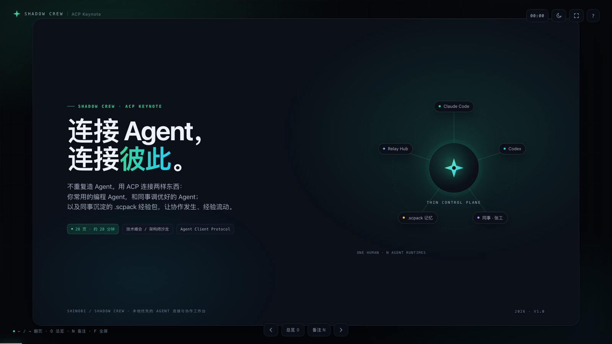

# Shadow Crew · ACP 技术宣讲（HTML Keynote）

> 单文件、离线、16:9、35 页（28 页正文 + 7 页 ACP 实操附录）。用 PPT 的节奏讲，用 HTML 的方式分发。
>
> 核心主张：不重复造 Agent，把常用的编程 Agent、同事调优好的 Agent 与 `.scpack` 经验包连接在同一个工作台。协作把过程交给工作流，让人只关注结果；同事不在场，经验也一直在线。



## 打开方式

```bash
open docs/presentation/shadow-crew-acp-keynote.html
```

推荐 Chrome / Edge / Safari。进入后按 `F` 全屏，观众只看舞台；鼠标静止 3 秒后，顶部与底部控件会自动淡出。

## 为什么用“幻灯片模式的 HTML”，而不是纯滚动长页

- **讲**：一屏一个观点，节奏由讲者控制；字号按 1600×900 舞台设计，投屏不散。
- **读**：`O` 打开 35 页总览，可当作目录跳转；地址栏 `#12` 可深链到指定页。
- **带走**：`⌘P` / `Ctrl+P` 直接导出 35 页 PDF，自动切浅色打印主题并隐藏控件。
- **分发**：一个约 175KB 的 HTML，无 CDN、无外部字体、无构建步骤，发给同事即可打开。

纯滚动长页更适合“会后异步阅读 / 全文检索 / 嵌入交互 Demo”。若需要，可基于同一份内容另出一版长文。

## 讲解控制

| 操作 | 快捷键 |
| :--- | :--- |
| 下一页 / 上一页 | `→` `←` `Space` `PageUp` `PageDown` |
| 首页 / 末页 | `Home` / `End` |
| 幻灯片总览 | `O` |
| 讲师备注 | `N` |
| 演讲计时（双击归零） | `T` |
| 明暗主题 | `D` |
| 全屏 | `F` |
| 快捷键帮助 | `?` |
| 关闭浮层 | `Esc` |

移动端支持左右滑动翻页。

## 页面结构

| 页码 | 板块 |
| :--- | :--- |
| 01–04 | 开场、单/多 Agent 取舍、三个协作问题、责任边界（Thin Control Plane） |
| 05–06 | ACP 对等架构、宿主控制层（协议之外补了什么） |
| 07–09 | V1 → V2、六维对照、双栈协商 |
| 10–12 | 工具归属（端点优先 / 宿主兜底）、CWD 会话约束、增量上下文水位线 |
| 13–16 | 反向权限代理、4+1 博弈、BWM 仲裁、防从众治理 |
| 17–21 | 五大控制面、原生记忆、`.scpack`、零污染卡带、跨机互联 |
| 22–24 | 四种协作形态、四维矩阵、五个设计选择 |
| 25–28 | Live Demo、ROI、方向、结语 |
| 29–35 | ACP 实操附录：全流程、capabilities、V1/V2 方法地图、最小报文、接入检查清单、参考论文 |

每页的讲师话术来自 [`TECH_PRESENTATION_SHADOW_CREW_ACP.md`](./TECH_PRESENTATION_SHADOW_CREW_ACP.md)，按“先结论、再展开”的节奏改写，直接按 `N` 即可看到。

## 编辑指南

- 每页是一个 `<section class="slide" data-no="01" data-section="开场" data-title="..." data-notes="...">`。
- 增删页面时，需要同步三处总数：CSS 中 `.slide::after` 的 `/ 35`、总览标题「全部 35 页」、封面 chip「35 页 · 约 35 分钟」。
- 主题令牌集中在文件顶部：`:root`（暗夜）与 `html[data-theme="light"]`（白昼），打印样式在 `@media print` 中强制浅色。
- 品牌标记目前是内联四角星 SVG，可替换为 `public/ninja_icon.svg` 或产品正式 Logo。
- 页面按 1600×900 设计，由 JS 等比缩放适配窗口，新增内容请保持 16:9 画布内不溢出。

## 数据口径

- 文案、数字与对标结论均取自 [`TECH_PRESENTATION_SHADOW_CREW_ACP.md`](./TECH_PRESENTATION_SHADOW_CREW_ACP.md)；ACP 方法与能力按官方 v1 / v2 规范整理。
- ACP V2 目前仍为 Draft；附录页已标注，正式对外前请再核对版本状态与 schema。
- 多角色 / 任务拆解 / 验证机制的论文依据与适用边界见第 35 页（附录 A7）；不做“多 Agent 必然优于单 Agent”的断言。
- ROI 页已显式标注「单场架构研讨 Demo 实测与项目内测数据」，对外演讲前请按最新版本复核模型名、版本号与收益数字。
